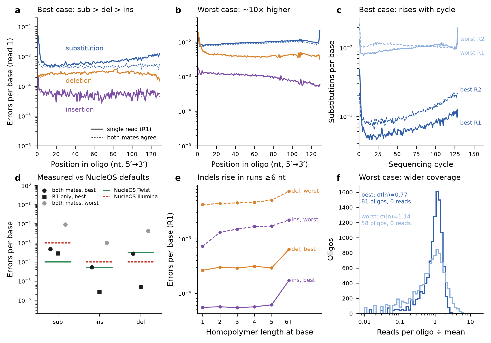

# Nucle-OS Architecture

## Design Philosophy

Nucle-OS follows the same bottom-up layered architecture as [FerrumOS](https://github.com/VyomKulshrestha/Ferrum-OS). Each layer is a separate Rust crate with well-defined responsibilities and clean interfaces to adjacent layers. Dependencies flow toward foundational crates — lower layers never depend on higher application layers.

## Layer Dependency Graph

```text
nucle-cli
├── nucle_agent ───────────────→ nucle_vfs
├── nucle_blockdev ────────────→ nucle_codec, nucle_ecc, nucle_synth
├── nucle_hardware ────────────→ nucle_lang
├── nucle_lang ────────────────→ nucle_vfs, nucle_codec, nucle_synth
└── direct core dependencies ──→ nucle_codec, nucle_ecc, nucle_index,
                                 nucle_synth, nucle_vfs

nucle_lsp ─────────────────────→ nucle_lang
nucle_playground ──────────────→ nucle_demo_core, nucle_lang
nucle_wasm ────────────────────→ nucle_demo_core, nucle_lang
nucle_demo_core ───────────────→ nucle_codec, nucle_ecc, nucle_synth

nucle_vfs ─────────────────────→ nucle_index, nucle_ecc, nucle_codec, nucle_synth
nucle_index ───────────────────→ nucle_ecc, nucle_codec, nucle_synth
nucle_ecc ─────────────────────→ nucle_codec, nucle_synth
nucle_synth ───────────────────→ nucle_codec
nucle_codec                     (foundation)
```

This graph reflects normal (non-dev) dependencies from `cargo metadata`.
Dependencies flow toward lower-level crates; no core layer imports a higher
application layer.

`nucle_lang`'s desktop execution backend is a default `runtime` feature. The
browser build disables that feature, retaining lexer/parser/type checking,
simulation, formatting, and playground analysis without pulling the desktop
VFS, file locks, or encryption stack into `wasm32-unknown-unknown`. CLI/LSP and
native library users keep the runtime feature by default.

## NucleScript Language Layer

`nucle_lang` is the NucleScript compiler crate. It sits above the VFS and turns
`.nsl` source files into NucleOS operations:

```text
NucleScript source (.nsl)
    → lexer
    → parser / AST
    → semantic + biological constraint checks, including
      compile-time if/for desugaring (typeck::check_and_desugar)
    → bio-aware MIR
    → redundancy/profile optimizer
    → VFS backend or simulation backend
    → NucleOS syscalls or no-hardware plan
```

The compiler currently supports declarative pool definitions, store/retrieve
operations, simulation options, pipeline programs, DNA-native `Sequence`
literals such as `seq"ATCGATCG-GCTAGCTA"`, probabilistic pool annotations
such as `Pool<Illumina, 0.35%>`, compile-time `if`/`for` control flow
with comparison/boolean operators (`==`, `!=`, `<`, `>`, `<=`, `>=`, `&&`,
`||`, `!`), and `Result<T, E>`/`?` for genuinely catchable VFS failures
(see below). Sequence literals are validated at compile time for DNA
alphabet, GC balance, homopolymer length, and hairpin-prone palindromes.
Probabilistic pool bindings are checked for profile/state compatibility and
propagate an error budget through consensus recovery. Effect checking
classifies operations as `Pure`, `Synthesis`, `Sequencing`, or
`Destructive`; hardware effects require `confirm hardware`, and destructive
effects require `confirm physical_key`. The MIR optimizer raises insufficient
redundancy for the selected profile and coverage before either executable VFS
lowering or no-hardware simulation planning.

All three grammar-level codecs execute through the VFS backend. A pool-level
`codec: Fountain` controls ordinary `store` operations, while a pipeline's
`encode "..." using Fountain` controls its lowered store call; both map to
`CodecKind::Fountain`, persist `dna-fountain` plus the representation's exact
`FountainConfig`, and decode through the recorded metadata. The runnable
[`fountain_roundtrip.nsl`](examples/fountain_roundtrip.nsl) example exercises
both paths, and its pipeline performs a real byte comparison after VFS
readback. This intact-set roundtrip is narrower than an arbitrary-loss
guarantee: outer Reed–Solomon has the hard
`2*errors + erasures <= parity_count` bound, while any recovery beyond that
bound depends on the surviving Fountain equations having full rank.

`if`/`for` are resolved entirely inside `typeck::check_and_desugar`, before
any of that MIR/optimizer/backend machinery runs — before `Result<T, E>`/`?`
(below) existed, NucleScript's execution model was "compile a static plan, then run it,"
with no runtime branch or loop anywhere in a compiled program.
`check_and_desugar` evaluates each `if` condition once and keeps only the
taken branch (the untaken branch is never type-checked, closer to
`#[cfg(...)]` than a real conditional), and unrolls each `for` by
substituting the loop binding with every item in its literal list. The
result is a plain, control-flow-free `Program` — `middle` never sees an
`if`/`for` node at all. See
[docs/grammar.md](grammar.md#control-flow-if--for) for the full semantics
and a worked example.

### Whole-program name and value soundness

Top-level function signatures are collected before any body is checked,
so forward calls and mutually recursive signatures resolve independently
of declaration order. Effect analysis uses a least fixed point for call
cycles: a recursive back-edge contributes no new effect, while any real
hardware/destructive operation in the cycle still propagates normally.

Value checking covers every expression context, not only probabilistic
`Pool` bindings. Ordinary `let` annotations, function and closure
arguments, nested calls, and every non-`Void` implicit return are checked
against their declared types. Result- and enum-producing calls reuse the
same authoritative arity/generic/argument validator as Pool/scalar calls.
`protect` is a strict `protect(File, Recovery) -> DnaFile` intrinsic and
preserves its input file value at runtime. Scalars likewise compose across
`Ok`, computed `Err`, enum payloads, and match arms.

### Structured error handling (`Result<T, E>` / `?`)

The one place NucleScript actually has a runtime, as opposed to a
compile-time-resolved plan. Before this, `store`/`retrieve`/`delete`
either succeeded or aborted the entire program via a bare `?` inside
`codegen::execute_program` — there was no way for a NucleScript program to
observe, inspect, or recover from an operation failure, and a function
call was purely a compile-time signature lookup (`typeck::TypeChecker::
infer_expr`'s `FunctionCall` arm), never something that actually ran.

`store`/`delete` can now also appear in *expression* position
(`Expr::StoreExpr`/`DeleteExpr`, reusing the exact `StoreOp`/`DeleteOp`
structs the statement form already carries — one grammar, two surface
positions), producing a `Result<T, Str>` a postfix `?` (`Expr::Try`) can
unwrap or propagate to the enclosing function's own `Result` return type.
`middle`/`MirOp` is deliberately untouched by this and stays that way —
it still has zero notion of control flow or function bodies. Instead,
`codegen.rs` gained a small, real interpreter (`eval_expr`/
`exec_function_body`/`call_user_function`, sharing a minimal `value::
{Value, EvalOutcome}` runtime representation with a lighter-weight
narrating counterpart in `sim_backend.rs`) that runs directly off the
already-desugared `Program`, executing a called function's body for the
first time in this compiler's history — Rust's own call stack serves as
NucleScript's; no bytecode VM was introduced. A function's own internal
`?` short-circuit resolves entirely within that function's call: the
caller always sees an ordinary, already-wrapped `Result` value at the
call site, never an automatic propagation of its own.

Backward compatibility here is a build-time guarantee, not a review-time
one: every `Expr`/`Declaration` match this touches has no wildcard arm,
so the new AST variants were a compile error in each of `effects.rs`,
`typeck.rs`, `middle.rs`, `docgen.rs`, and `nucle_lsp/src/backend.rs`
until explicitly handled. A golden-file regression test
(`nucle_lang/tests/result_backward_compat.rs`) additionally pins every
pre-existing example's execution output to what it was on the commit
before this feature landed. See the "Result / Error Propagation" section
of [docs/grammar.md](grammar.md) for the full semantics, plus "Pattern
Matching" below for `match`/`Ok`/`Err`.

**A real, pre-existing gap in this interpreter, closed only later**:
`exec_function_body` originally only ever processed
`Declaration::Let` — a bare statement-form `store`/`retrieve`/`delete`
inside *any* function body (present in the source, type-checked, never
producing the function's own return value) was silently skipped, never
reaching the real VFS, regardless of whether closures existed yet. Fixed
by adding a `Declaration::Operation` arm that reuses the same
VFS-executing helpers the top-level path already had; a statement-form
failure inside a function aborts that function unconditionally (the same
all-or-nothing contract the top-level form always had), which a caller
catches through the ordinary `?`/`match` machinery. Paired with making
`Expr::StringLiteral` a real, unconditional `Value::Str` (previously an
inert placeholder) — what makes a `File`/`Str`-
typed *parameter*'s argument become a real, bound value inside the
callee's own `env`, which `store <ident> into <pool>`'s existing "file
variable" syntax (accepted since it was written, never actually resolved)
now resolves through via a new `resolve_file_arg` helper.

The language layer now exposes ecosystem-facing integration points:

- `import { ... } from "nuclescript/presets"` validates built-in presets with
  the same resolver shape a package registry can extend.
- `analyze_source` returns serializable diagnostics, optimizer notes, simulation
  steps, and VFS call counts for browser playgrounds.
- `collect_hardware_requests` extracts synthesis, sequencing, and destructive
  requests from effectful MIR so a hardware bridge can submit them without
  changing NucleScript source syntax.

Every declaration/operation in the AST (`PoolDecl`, `LetDecl`, `StoreOp`, and
so on) carries a `Span { line, column, end_line, end_column }`, threaded from
the lexer's token positions through the parser and into every diagnostic
`typeck::check_program` produces. Every diagnostic also carries a stable
`code` (see [docs/errors.md](errors.md)) and, for the most common
undeclared-name mistakes, a "did you mean X?" suggestion via edit-distance
matching against names actually in scope. `nucle check` renders this as a
rustc-style snippet — `file:line:column`, the offending source line, and a
`^^^` underline — and the playground API exposes the same structured data
as JSON, so both the CLI and current editor integration read from one
diagnostic shape, not two that can drift.

> See [docs/grammar.md](grammar.md) for the full formal syntax reference,
> [docs/effects.md](effects.md) for the effect model — including how effects
> propagate through function calls, not just literal operations — and
> [docs/stdlib.md](stdlib.md) for `consensus_vote`/`protect`, NucleScript's
> two built-in functions.

`consensus_vote` and `protect` are ordinary `FunctionTable` entries
(`stdlib::builtin_functions`), not separate AST nodes with their own
hardcoded type-checking/effect logic. The parser still accepts their
existing keyword-sugar surface syntax (`consensus_vote(source, coverage:
N)`, `protect data for guarantee`) but desugars both directly to
`Expr::FunctionCall` at parse time, so arity checking, effect propagation,
and "did you mean X?" suggestions all flow through the exact same path a
call to a user-defined `fn` does — `effects::function_table` seeds a
program's function table from the built-ins before overlaying its own `fn`
declarations, and `typeck::TypeChecker::lookup_function` does the same for
type-checking. `consensus_vote`'s actual return type still needs one
narrow, explicit intrinsic-recognition branch
(`TypeChecker::infer_consensus_vote`), because its result genuinely
depends on its *argument values* (the source binding's inferred error
rate, the requested coverage) — a real compiler-level computation no
fixed declared signature could express, not something the shared
function-call machinery skipped by accident.
`simulate`/`synthesize`/`sequence` stay as dedicated grammar forms rather
than joining the stdlib, since their `confirm hardware` effect-
confirmation semantics are load-bearing enough to want a real grammar
production of their own.

A TextMate grammar for `.nsl` files lives at
`editors/vscode/nuclescript/syntaxes/nuclescript.tmLanguage.json`, derived
from `docs/grammar.md`/the actual keyword sets in `lexer.rs`/`parser.rs`
(not invented independently), and is snapshot-tested against every file in
`docs/examples/` (`vscode-tmgrammar-snap`) so grammar/compiler drift shows
up as a diff. This is purely presentational; live diagnostics, hover, and
navigation come from the language server below.

### Generics (`fn name<T>(...)`)

Resolves entirely at type-check time, with no runtime representation and
no per-instantiation re-checking of a function's body — neither classic
monomorphization (generating a fresh copy of code per concrete type) nor
dynamic dispatch, because this codebase's actual constraints make both
unnecessary: `Profile` (`Illumina`/`Nanopore`/`Twist`/`IDT`) is a closed, flat
enum with no subtyping anywhere in the language, so variance never comes
up, and effect classification (`effects.rs`) never inspects a pool's
profile at all — every operation already behaves identically across all
three. Concretely: `PoolState` (the state slot inside `Pool<...>`) gains
a fourth variant, `Var(String)`, an unbound type parameter that a
generic function's body is type-checked against exactly once, opaquely —
the *existing* fallback typeck already uses when it needs a concrete
`Profile` but only has a non-`Profile` state (`Amplified`/`Recovered`)
absorbs `Var` for free, with zero new code, since it was already a
wildcard. At each call site, `infer_expr`'s `FunctionCall` arm unifies
every `Pool<T>`-typed argument against the parameter's `Var`, building a
substitution used only to (a) catch the same type parameter being bound
to two different profiles in one call (`E-TYPE-PARAM-CONFLICT`) and (b)
resolve a return type that mentions the type parameter to the concrete
type for that specific call. `codegen.rs`'s interpreter (the one added
for `Result<T,E>`/`?` above) needs zero changes — it resolves a function
call purely by name and executes whatever concrete `Value`s were passed,
with no notion of "generic" at any point. See the "Generics" section of
[docs/grammar.md](grammar.md) for the full semantics, including the one
honest limitation (a handful of profile-specific typeck warnings can't
fire while checking a generic body against an abstract type parameter).

**Explicit type-argument syntax, `name::<Illumina>(...)`**:
seeds the call's substitution map from the explicit arguments (zipped
against the function's own declared `<T, U>` list) *before* the
pre-existing per-argument unification loop runs, reusing the same
`E-TYPE-PARAM-CONFLICT` an ordinary disagreeing argument already reports,
plus a new `E-TYPE-PARAM-ARITY` for the wrong explicit-argument count.
This closes the one real gap the original design left: a type parameter
that appears *only* inside a `Fn(...)`-typed parameter's own signature,
never as a directly `Pool<P>`-shaped argument itself, has nothing for the
named-function argument loop to unify it from (that loop only inspects
`TypeExpr::Pool`-shaped arguments; a `Fn(...)`-typed argument is validated
by a separate helper, `check_fn_typed_arg`, that doesn't feed the outer
substitution map at all) — an explicit type argument is the only way to
call it.

### Enums (`enum` declarations) and general pattern matching

Two related gaps stood open from earlier in the language's development,
named explicitly at the time: a general pattern-matching/exhaustiveness
engine (needing user-defined enums, which didn't exist at all) and
accurate effect analysis through an arbitrary closure call (deferred
separately, still open). This closes the first.

`ast::EnumDecl { name, variants: Vec<EnumVariant>, span, doc }` is a new
top-level declaration, each variant at most one payload
(`Variant`/`Variant(Type)`, mirroring `Ok(T)`/`Err(E)`'s own shape — no
tuple/struct variants). `EnumName::Variant`/`EnumName::Variant(payload)`
(`Expr::EnumConstruct`) reuses the `::` token turbofish already uses,
disambiguated by one token of lookahead (turbofish's `::` is
always followed by `<`; a variant reference's is always followed by an
identifier). `TypeExpr::Enum(String)` is a new type-expression case;
concretely, `parse_type_expr`'s previously-hard-error fallback branch now
treats *any* unrecognized identifier as presumably naming a user enum,
deferring the real validation to typeck (`check_enum`/`enums` lookup)
rather than teaching the parser NucleScript's set of declared names.

**Result unification happens at exactly one layer: matching, not
construction or runtime storage.** The user-facing ask was for `Result<T,
E>`'s existing `match`/`Ok`/`Err` machinery to run through the same
general engine as a real user `enum` — not for `Result` to become
literally an instance of the `enum` mechanism. `Expr::Ok`/`Expr::Err`
stay their own dedicated, unprefixed `Expr` variants, untouched:
`Err`'s payload has a bespoke `Str`-typed restriction (literal, bound
value, or `Str`-returning call) that doesn't generalize to arbitrary enum
variants, and folding construction
into one path would mean either a magic `enum_name == "Result"` special
case or silently dropping that restriction. `Value::Result` similarly
stays a distinct runtime representation; a new `Value::EnumInstance {
enum_name, variant, payload }` is a *sibling*, not a replacement — the
dozens of existing `codegen.rs` sites pattern-matching `Value::Result(Ok
(_)/Err(_))` directly in the hottest, most safety-critical control-flow
path (`?`'s short-circuit, `call_user_function`'s auto-wrap) stay exactly
as they were, compiler-checked and exhaustive, rather than becoming
stringly-typed `variant == "Ok"` comparisons for zero behavioral gain.

The unification lives entirely in `typeck::check_match`/`codegen.rs`'s
`eval_expr` Match arm. `check_match` first resolves what's being matched
via a new `ScrutineeKind` (`Result { ok_ty, err_ty }`, whose two variants
are always exactly `Ok`/`Err`; or `UserEnum { decl }`, a real `EnumDecl`
looked up by name) — through a new `infer_scrutinee_kind`, which tries
the existing, completely unchanged `infer_result_expr` first, and only
falls back to resolving an enum name (from an `EnumConstruct`, an
enum-typed variable, a closure/function call's declared return type, or
a nested `match`) if that fails. Either way, the same four-pass check
runs: shape-check every arm against the scrutinee's own
`declared_variants: &[VariantSignature]` (unknown variant name, wildcard
not last, duplicate arm), exhaustiveness (one arm per declared variant,
or a trailing wildcard), per-arm type-check via
`check_match_arm_general`, then unify every arm's resolved type. `eval_
expr`'s runtime side is unified the same way: a new shared `run_match_
arm` helper extracts `(variant_name, payload)` uniformly from either a
`Value::Result` or a `Value::EnumInstance`, finds the arm whose `variant`
matches (falling back to a wildcard), and evaluates its body in a cloned
environment — bit-for-bit the same outcome for any existing 2-arm Result
match, the core of the zero-regression proof (`result_backward_compat.
rs` re-run completely unmodified, still green).

**Arm order is now free, checked by variant name rather than
position** — a deliberate, confirmed behavior change from the fixed
Ok-then-Err order originally required (`match r { Err(e) => ...,
Ok(v) => ... }` is now exactly as valid as the reverse). `Expr::Match`'s
shape changed accordingly, from four hardcoded fields
(`ok_pattern`/`ok_body`/`err_pattern`/`err_body`) to `{ scrutinee, arms:
Vec<MatchArm> }`, `MatchArm { variant: Option<String>, binding:
Option<String>, body, span }` (`variant: None` is the wildcard) — a real,
compiler-enforced breaking change that turned every existing `Expr::
Match` construction/destructuring site across the workspace into a
compile error until updated, the same forcing function every prior
feature relied on.

**The old cross-arm-context trick, correctly generalized.**
Re-reading the old "hand the `Err` arm the `Ok` arm's own resolved value
type" logic closely revealed it never actually needed a sibling arm's
*resolved* value at all — only the scrutinee's own *declared* Ok-side
type, already fully known statically before any arm is checked. So the
N-arm generalization turned out simpler than an accumulator-based
"resolved so far" threading: `check_match_arm_general` receives the full
`declared_variants` list as static context up front, and `Ok(pattern) =>
Ok(pattern)`/`Err(pattern) => Err(pattern)` resolve by looking up the
other of `Ok`/`Err` inside it directly. The general `EnumName::Variant
(pattern) => EnumName::Variant(pattern)` re-wrap needs no "other side" at
all — just its own variant's declared payload type.

**A real, user-flagged limitation fixed properly, not worked around.**
`check_match_arm_general`'s dispatch for "a nested `match` as an arm's
body" originally only accepted an inner match whose *own* resolved type
was Result-shaped — an inner match whose every arm already used `?`
(producing a bare, unwrapped value) was rejected with
`E-MATCH-ARM-UNTYPABLE`, even though the outer match's own dispatch
handles a bare bound name fine. Generalized to delegate directly to
`self.check_match(body, span)` and accept whatever it resolves to —
Result-shaped, enum-shaped, Pool-shaped, or already-bare — a strictly
more general and correct fix, verified not to break any existing test.

**Two real gaps surfaced by hands-on testing of the shipped example, now
both closed.** (1) Enum-typed
function/closure parameters were invisible to scope — no `LetDecl`
registers a parameter, so the existing `pool_bindings`/`result_bindings`
convention had no equivalent for an enum-typed parameter until a new
`enum_bindings: HashMap<String, String>` field was added, populated in
`check_let`'s new `Expr::EnumConstruct` branch and both param-seeding
loops (`check_function`/`check_closure_expr`). (2) Scalar values are now
inferred uniformly across `Ok`, `Err`, enum payloads, and match arms:
string literals, bound `Str` values, and validated scalar-returning calls
all compose without special-case syntax, and codegen evaluates computed
`Err` messages into a real runtime `Result::Err`.

`effects.rs`/`middle.rs`/`sim_backend.rs` all generalized their `Expr::
Match` handling from two hardcoded arms to a fold over `arms` (effect =
join across scrutinee + every arm; confirmation = AND across all of them
— the same conservative "every declaration in this join counts" rule
`if`/`?` already follow); `sim_backend.rs`'s `narrate_result_expr` in
particular has a real, not-compiler-enforced wildcard `_` arm (same as
before this step), so its generalization was written and verified
explicitly rather than relying on the compiler to force it.
`formatter.rs` needed *zero* changes — its existing token-based rules for
braces/commas/keywords were confirmed, by direct testing, to already
generalize correctly to `enum` declarations, `EnumName::Variant`
construction, and N-arm `match` bodies. See the "Enums"/"Pattern
Matching" sections of [docs/grammar.md](grammar.md) for the full surface
semantics, and
[`docs/examples/recovery_plan.nsl`](examples/recovery_plan.nsl) for a
complete, runnable example exercising a user enum, a nested match, and
exhaustiveness via a trailing wildcard.

### Closures (`Fn(...)` / `fn(params) -> T { body }`)

The capture-semantics question this was originally deferred over ("by
value or by reference? what does capturing a mutated-in-place pool even
mean?") turned out to have a structural, not chosen, answer: every `let`
binding in NucleScript is single-assignment, so there is no "later
mutation" a by-value/by-reference distinction could ever observe --
capture-by-snapshot is simply correct here, not a design compromise.
Separately, pools are never mutated *as bindings* -- `store`/`delete`
reference a `pool` *declaration* by name (always globally visible),
never a captured probabilistic binding -- and have no runtime `Value`
representation at all, so "capturing a pool" was never a coherent
runtime operation to begin with. Capture in `codegen.rs`'s `eval_expr`
is therefore just one `env.clone()` at the point a closure literal is
evaluated (`Value::Closure`'s `captured_env` field) -- nothing to
filter, since `env` already only ever holds `Value`-representable
things (a captured `Pool`/`Strand`/`Sequence` binding, if present at
all, is an inert `Value::Unit` placeholder, exactly as harmless to
capture as it already is to pass around anywhere else).

Calling a closure reuses the *existing* `name(args)` surface syntax
(`Expr::FunctionCall` is completely unchanged) -- typeck's `self.closures`
map and the runtime's `env`-before-`funcs` lookup both resolve a
closure-bound name *before* falling back to the global function table,
so a call site looks identical whether `name` is a top-level `fn` or a
local closure.

**Self-recursion — the one genuine runtime bug found in this
whole language's development, not a design gap.** `codegen.rs`'s
`call_closure` always started a call's own `env` fresh from
`captured_env`, the snapshot `Expr::Closure` takes at evaluation time --
*before* its enclosing `let` finishes binding, so `captured_env` never
contains the closure's own name. A self-recursive call therefore actually
resolved to "internal error: undeclared function," silently wrapped into
a `Value::Result(Err(...))` with no VFS step to show for it -- close
enough to a real, caught failure that a first hand-verification pass
misread it as the self-recursion actually working (one real failure plus
one silently-swallowed internal error looks identical to two real
failures unless you check the count). The real bug surfaced two ways: an
automated test asserting the *count* of real steps failed outright, and
once fixed, the fix immediately produced a stack overflow on the existing
example -- a closure retrying the exact same failing operation with no
changing state now genuinely recursed, forever, since nothing ever made a
later attempt behave differently. Fixed by having `call_closure`
re-insert the closure under the name it was just called through, into
its own fresh `env`, before running its own body -- on *every* call, not
just the first, which is what makes arbitrarily deep recursion work
rather than one level. The shipped example was redesigned alongside the
fix to retry into a genuinely different fallback target on the second
attempt, so the recursion is real *and* terminates.

**Generic closures, `fn<T>(...)`**: `Expr::Closure` gained its
own `type_params: Vec<String>`, mirroring `FunctionDecl`. Because a fresh
type-parameter name is only recognized inside a closure literal's own
declared `<...>` list at parse time (not inferred from surrounding
context), a generic closure is only expressible nested inside an
already-generic enclosing function/closure sharing the same
type-parameter name -- the parser's `type_params_in_scope` now *merges*
with the outer scope in both `parse_function_decl` and the new
`parse_closure_expr`, instead of clobbering it, since closures can nest
this way. `check_closure_call_args` was rewritten to perform the same
`PoolState::Var` unification a named function's call-site checking
already does, rather than a flat equality comparison -- surfacing and
fixing a real, latent false-positive `E-ARG-TYPE-MISMATCH` along the way
(a `Pool<Var>`-typed expected parameter was being compared for flat
equality against any concrete argument, which is always unequal).

**`nucle plan`/`nucle explain` narration through a `let`-bound closure's
own call**: `sim_backend.rs`'s `narrate_result_expr` now threads
a `closures: &mut HashMap<String, Vec<Declaration>>` map (name → body),
built incrementally by the same two declaration-walking loops that
already existed, checked *before* the named-function lookup -- the exact
priority `effects.rs`'s own earlier fix already established. A closure
received as a `Fn(...)`-typed *parameter*, or an inline closure literal
passed directly as a call argument, remains unnarratable, since neither's
real body is known at that call site, only at runtime -- this closes only
the `let`-bound case.

This is also why no cycle-guard machinery was needed for *mutual*
recursion between closures: capture only ever sees bindings from *before*
the literal's own position, so two independently-`let`-bound closures can
never see each other -- `codegen.rs`'s existing `calling`/`func.name`
guard (built for named function recursion) stays completely untouched.

`effects.rs` needed a real signature change, not just an additive match
arm -- the one place this feature couldn't stay purely additive. It's a
free-function pass over `&FunctionTable` with no visibility into
typeck's per-scope state, so `expr_effect`/`expr_has_required_
confirmation`/`function_call_effect` all gained a second `closures:
&FunctionTable` parameter: a synthetic `FunctionDecl` per `let`-bound
closure (real params/return_type/body, so its actual effect can be
computed by recursing into it, exactly like a named function already
can) that `typeck::TypeChecker::check_let` populates and passes through
at its own confirmation-gating call site -- the one place that actually
gates compilation. A `Fn(...)`-typed *parameter*'s call was left as a
real, deliberately open gap at the time (its real body isn't knowable
until runtime, so it was optimistically treated as `Pure`/confirmed, no
worse than the pre-existing "can't resolve, assume Pure" fallback for
any unresolvable name) -- closed by effect-annotated function types,
below. `sim_backend.rs`'s narrator has the identical, symmetric gap for
the same reason (it resolves callees by static name and has no runtime
environment to consult) and remains genuinely open -- see the "Closures"
section of [docs/grammar.md](grammar.md) for the full semantics.

### Effect-annotated function types

The other real gap `Fn(...)`-typed parameters left open: their call
inside a function body couldn't have its effect analyzed at all, since
the concrete closure a caller passes isn't knowable until runtime.
`TypeExpr::Fn` gained a third field, `Option<FnEffectAnnotation>`
(`Hardware`/`PhysicalKey`, mirroring the *only* two confirmation
keywords the language already has -- `confirm hardware` for
`Synthesis`/`Sequencing`, `confirm physical_key` for `Destructive`) --
`None` for every `Fn(...)` type written before this feature, preserving
today's exact behavior unconditionally. Surface syntax reuses the exact
existing `confirm`/`hardware`/`physical_key` tokens
(`Fn(...) -> T confirm hardware`), so no new lexer tokens were needed.

**The soundness argument, and the hole an architecture-review pass found
in the first draft.** The only place a *concrete* closure value is ever
created is an `Expr::Closure` literal -- a parameter, a `let`-bound name,
or a captured name inside a nested closure is always just an alias to a
closure created somewhere else. So the actual invariant needed is: a
call to any `Fn(...)`-typed expression is sound to trust as
`(declared_effect, confirmed=true)` as long as every concrete closure
ever bound into that annotated slot was checked against the ceiling
*once*, wherever it was concretely bound -- not re-derived at the
parameter's own call site. The first draft's design checked this only
for the explicit-argument-passing case; a dedicated review pass found
that a *capture* (an inner closure calling an annotated *outer*
parameter, never passed as an explicit call argument at all) was never
covered, which would have made the ceiling untrustworthy for that case.
The fix, adopted in the final design: run the *same* effect computation
uniformly everywhere a concrete closure is bound into an annotated slot
(`typeck::TypeChecker::check_fn_effect_compatibility`, called from both
`check_fn_typed_arg` and `check_let`'s existing closure-registration
flow), always using the *current* scope's real `fn_param_effects` --
this naturally resolves the capture case for free (the enclosing
function's own annotated parameters are already in scope when the inner
closure's effect gets computed) and the *forwarding* case too (an
annotated parameter passed straight through as another function's
compatibly-annotated parameter resolves via its own trusted ceiling,
no real body needed) with no special-casing for either.

Concretely: `effects.rs` gained `fn_param_effects: &HashMap<String,
Effect>` as a new parameter threaded through `expr_effect`/`expr_has_
required_confirmation`/`function_call_effect`/`decl_effect_info` (mapping
a `Fn(...)`-typed parameter's name to the `Effect` its annotation stands
for) -- `function_call_effect`'s existing "unresolvable name" fallback
now checks this table before defaulting to `(Pure, true)`. A new
`effects::scoped_fn_param_effects` builds the table a callable's *own*
body should be resolved against: its own annotated parameters (always
authoritative -- a name collision could only type-check if the callable
itself also declares that name) layered over whatever the enclosing
scope already had (meaningful only for a closure, which really does
capture lexically). `function_call_effect`'s own body-joining loop was
extracted into a new `effects::body_effect`, reused by `typeck::
TypeChecker::check_fn_effect_compatibility` to compute a closure
*literal*'s effect directly (it has no name of its own to resolve a call
against). `typeck::TypeChecker` gained a parallel `fn_param_effects:
HashMap<String, Effect>` field, populated in `check_function`'s and
`check_closure_expr`'s existing parameter-seeding loops and cloned into
child checkers the same way `closures`/`closure_decls` already are.

**Deliberately not attempted**: distinguishing `Synthesis` from
`Sequencing` at the annotation level -- the language's own `confirm
hardware` doesn't distinguish them either, and `nucle_hardware`'s
`collect_hardware_requests`/`middle::lower_program` are already strictly
top-level-scoped, never walking into any function or closure body at all
(verified directly: `Declaration::Function` is an explicit no-op there),
so this analysis's output was never going to reach that pipeline either
way, annotated or not. `sim_backend.rs`'s narrator remains genuinely
unable to see through an annotated parameter's call -- a declared
ceiling is not a real body to synthesize a concrete VFS step from; only
whole-program flow analysis (the option not taken) could close that
specific, narrower gap.

**A second, unrelated real bug found while building the verification
example.** `codegen.rs`'s `is_result_producing` (gating whether a
top-level `let` is routed through the real interpreter at all) only ever
returned `true` for a call to a `Result<_, _>`-returning function --
correct before statement-form execution existed, wrong afterward: a
top-level `let result: Void = do_thing()` where `do_thing`'s body has a
real statement-form `store`/`delete` silently never ran it, with no
error and no diagnostic, discovered because the effect-annotated-`Fn
(...)`-types example is specifically a top-level call chain into a
genuinely `Destructive` closure. Fixed by routing any function call
through `eval_expr` except one returning a compile-time-only type
(`Pool<...>`/`Strand`/`Sequence`/`File`/`Recovery`, none of which
`value::Value` has a runtime representation for at all, so `eval_expr`
has nothing to produce for them anyway).

See the "Effect-Annotated Function Types" section of
[docs/grammar.md](grammar.md) for the full surface semantics, and
[`docs/examples/effect_annotated_closure.nsl`](examples/effect_annotated_closure.nsl)
for a complete, runnable example -- verified directly with `nucle doc`,
which now shows both functions in the example correctly reporting
`Destructive (confirmed)` rather than the previous, silently wrong
`Pure`.

### Language Server (`nucle_lsp`)

`nucle_lsp` is a thin LSP protocol adapter, not a second compiler: every
answer it gives comes from `nucle_lang::analyze` (`typeck::
check_program_with_symbols` under the hood), the exact same pass `nucle
check` and the playground already run. `typeck::TypeChecker`'s own
scope-tracking (`pools`, `functions`, `strands`, `sequences`, `bindings`)
is exposed as a `SymbolTable` — top-level declaration name/span pairs —
specifically so the language server doesn't re-derive a second, possibly
divergent notion of "what's declared where." `nucle_lsp/src/backend.rs`
implements:

- `textDocument/didOpen`/`didChange` → `publishDiagnostics`, using the
  same `Span`/error `code` every CLI diagnostic already carries.
- `textDocument/hover` — finds the identifier at the cursor by slicing the
  open document's text (not a second AST — the server keeps document text
  in memory and re-parses on every request, since NucleScript programs are
  small and re-parsing is cheap), then looks it up in the `SymbolTable`.
- `textDocument/definition` — same lookup, returning the declaration's
  span as the jump target.
- `textDocument/documentSymbol` — the whole `SymbolTable` as an outline.
- `textDocument/completion` — context-aware keywords, types, profiles,
  codecs, built-ins, and symbols from the compiler-owned table.
- `textDocument/references` and `textDocument/prepareRename`/`rename` —
  whole-document identifier references and a guarded rename that refuses
  keywords, built-ins, and unresolved names.
- `textDocument/semanticTokens/full` — declaration/reference classes for
  functions, variables, types, enums, enum members, parameters, and
  properties, with all LSP positions converted to UTF-16 code units.

Verified with in-memory duplex-pipe integration tests
(`nucle_lsp/tests/diagnostics.rs`) that speaks the real Content-Length-
framed JSON-RPC protocol — not just unit tests of the internal Rust
functions — and cross-checks the published diagnostics against
`nucle_lang::check_source`'s own output for the identical source, so the
server can't silently drift from what the CLI reports.

The VS Code extension (`editors/vscode/nuclescript/src/extension.ts`)
spawns the `nucle-lsp` binary over stdio via `vscode-languageclient` — the
one place in this stack that's TypeScript rather than Rust, kept to
"spawn and connect" with no logic of its own. `src/serverDownload.ts`
resolves which binary to spawn: an explicit `nuclescript.serverPath`
setting, then `nucle-lsp` on `PATH` (local development), then a prebuilt
binary for the current OS/architecture downloaded once from
`.github/workflows/release-vscode-extension.yml`'s GitHub Release output
and cached in the extension's global storage — the path a marketplace
install (no local Rust toolchain) needs.

`src/formatProvider.ts` (Format Document) and `src/runProvider.ts`
(`NucleScript: Run File`) both shell out to a separate `nucle-cli`
binary rather than `nucle-lsp` — different executable, same three-tier
resolution, via `src/cliDownload.ts`. It shares the actual HTTPS
fetch-and-cache logic with `serverDownload.ts` (factored into
`src/download.ts`) but downloads from the main NucleOS repo's own `v*`
release tags instead of `nucle-lsp-v*`, since `nucle-cli` ships as part
of NucleOS itself and is versioned independently of the extension —
`cliDownload.ts` pins a specific tag (`CLI_RELEASE_TAG`) rather than
deriving one from the extension's version. `runProvider.ts` runs
`nucle-cli run <file>` as a VS Code `Task` (`ShellExecution`) rather than
a raw child process, so its output shows up in an integrated terminal
the way a real "Run" command would, and argument quoting is handled by
the Tasks API instead of by hand.

The extension is published on the Marketplace under the `nuclescript`
publisher; see the extension's own
[CONTRIBUTING.md](../editors/vscode/nuclescript/CONTRIBUTING.md) for how
to ship an update (a manual `.vsix` upload, or the CI workflow if
`VSCE_PAT` is configured as a repository secret).

### Formatter (`nucle fmt`)

One canonical, zero-configuration style, `gofmt`-style: there is exactly
one way `nucle fmt` writes a given program, so a diff never contains
unrelated whitespace churn. `nucle_lang::formatter::format_source`
deliberately does **not** print from the AST — the AST drops comments and
normalizes literal spellings by design (see `ast.rs`), so printing from it
would silently delete every `//` comment. Instead it re-renders the real
token stream (`lexer::Lexer`, which already carries each token's
line/column from the lexer's own span-tracking work) plus a small dedicated scan for
comments (the one thing tokenizing discards), consulting the parsed
`Program` for exactly one thing: each top-level declaration's start line,
used to force exactly one blank line between top-level declarations
without splitting a leading doc comment away from the declaration it
documents.

Concretely, formatting keeps every line-break the input already has (no
line-wrapping heuristics for this first cut, matching how `gofmt` leaves
most multi-line constructs alone), recomputes indentation from bracket-
nesting depth, recomputes inter-token spacing from a small rule table, and
collapses blank-line runs to at most one everywhere. Because every rule is
a pure function of (tokens, comments, which line-breaks exist), running
the formatter on its own output is a no-op by construction, verified by
`nucle_lang/tests/formatter.rs` sweeping every file under `docs/examples/`
for both idempotence and "formatting never changes the parsed program."
`nucle_cli`'s `Fmt` command exposes `--check` (CI, exits non-zero if not
already formatted) and `--write` (rewrite in place); `nucle fmt -` reads
the buffer to format from stdin instead of a file, which is what the VS
Code extension's `Format Document`/format-on-save provider
(`src/formatProvider.ts`) shells out to, so there's exactly one formatting
implementation rather than a second one duplicated in TypeScript or the
language server.

### Test runner (`nucle test`)

`test "description" { ... }` (`ast::TestDecl`) is a named block of
declarations; `assert <condition>` (`ast::AssertOp`, valid anywhere a
declaration is, not just inside a test) is evaluated by the *exact same*
`typeck::TypeChecker::eval_condition` an `if` condition uses — there's no
separate assertion DSL, reusing `if`'s own existing
comparison operators. That's also why an assertion is checked at
type-check time rather than deferred to some later "runtime" phase:
NucleScript's probabilistic properties (a pool binding's inferred error
rate) are deterministic formulas computed at compile time already, not
something measured empirically, so there's nothing for an assertion to
wait for. A false assertion is reported as an ordinary `E-ASSERTION-FAILED`
diagnostic at its own span — `nucle check` surfaces one anywhere in a
program as a real bug on its own, with no dependency on `test_runner.rs`
at all.

`nucle_lang::test_runner::run_tests` is what turns that into pass/fail per
test: it runs `typeck::check_and_desugar` once over the whole program (a
*real* compile error anywhere — anything other than a failed assertion —
aborts the entire run before any test executes, the same way a type error
in a Rust test file stops `cargo test` from running anything), then for
each `TestDecl` in the desugared output, groups every `E-ASSERTION-FAILED`
diagnostic whose span falls within that test's line range into its
result. Independently, it builds a small "virtual program" per test (the
file's own non-test top-level declarations — pools, lets, functions — plus
that one test's body) and runs it through the exact same
`codegen::compile_program`/`execute_program` path `nucle run` uses,
against a fresh `NucleOS` instance per test for isolation — so a test can
also catch a genuine VFS failure (a `retrieve`/`delete` erroring out), not
just a failed assertion. `nucle_cli`'s `Test` command reports `cargo
test`-style pass/fail output (or `--json`).

The VS Code extension now wires `nucle test --json` into a native
`TestController`. A brace/string/comment-aware discovery pass registers
top-level `test "..." { ... }` blocks in source order; runs save dirty
documents, invoke the resolved `nucle-cli`, map failed test spans back to
source, stream output, and honor cancellation. The discovery/parser layer
has its own Node unit tests so editor behavior is verified without
requiring an Extension Host process.

### Doc comments and `nucle doc`

`///` is a real, distinct token (`lexer::TokenKind::DocComment`), not a
plain `//` comment with an extra slash discarded during tokenizing.
`parser::Parser::consume_doc_comment` accumulates every consecutive `///`
line immediately before a declaration into one `\n`-joined string, and
attaches it to a `doc: Option<String>` field -- present only on
`PoolDecl`/`StrandDecl`/`SequenceDecl`/`FunctionDecl`/`PipelineDecl`, the
five kinds of declaration with a real name and signature worth looking up
in generated docs. A `///` before anything else (a `let`, an operation,
`if`/`for`/`test`) is rejected with a parse error naming the offending
keyword (`reject_doc_comment`) rather than silently discarded — there's
no field to attach it to, so it's always a mistake worth surfacing.

`docgen::generate_docs` walks a `Program`'s top-level declarations of
those five kinds and renders one Markdown document, grouped by kind: each
entry gets its doc text (if any), its real NucleScript signature (not a
paraphrase), and its effect (via the same `effects::decl_effect_info` the
playground/`nucle explain` use, so a function that ends up `Synthesis`
because it calls `store` shows that, not just its declared return type).
An *un*documented declaration still gets an entry — the output is meant
to be a complete reference, not just whatever a program's author
remembered to comment. `nucle doc <source> [--output <file>]` exposes this;
default is stdout.

### Project scaffolding (`nucle new`)

`nucle new <name>` creates a directory with `main.nsl` (a self-contained
probabilistic-pool program that needs no external sample file, so `nucle
check`/`nucle run` succeed against it completely unmodified), a
`README.md` with the basic command reference, and an empty `nucle.lock`
(`lockfile::LockFile::default()`, serialized the same way `nucle package
lock` writes a populated one) — ready for `nucle package install` to
start populating once the project actually depends on something.

## NucleScript Playground

The interactive playground has four tabs, each backed by the real engine rather than reimplemented or mocked logic, and ships two ways from the same source:

- **`nucle_wasm`** compiles the compiler frontend/codec/ECC/noise engine to `wasm32-unknown-unknown` via `wasm-bindgen` and runs it entirely client-side — no server at all. It disables `nucle_lang`'s default desktop `runtime` feature, so browser analysis does not pull `nucle_vfs`'s file locking and at-rest encryption dependencies into WASM. Live at [nuclescript.github.io/playground](https://nuclescript.github.io/playground/), rebuilt and redeployed to GitHub Pages by `Nuclescript/playground`'s `.github/workflows/pages.yml` on every push.
- **`nucle_playground`** is a thin `tiny_http` HTTP server exposing the same operations over `POST /analyze`, `/benchmark`, `/pipeline-demo`, `/shelf-life`, for anyone who wants a native binary instead of a browser tab.

Both frontends call into the exact same logic — `nucle_wasm` and `nucle_playground` both depend on `nucle_demo_core` (a pure, I/O-free crate holding the benchmark and pipeline-visualizer implementations) plus `nucle_lang::playground::analyze_source` for the Write & Run tab, so there is one implementation to keep correct, not two that can drift.

- **Write & Run**: returns `PlaygroundReport` as JSON containing compiler diagnostics, simulator steps, and optimizer notes — the same `analyze_source` API `nucle check --json` uses.
- **Benchmark Explorer**: accepts `{ codec, profile, redundancy, data }` and returns density, GC distribution, homopolymer violations, and an estimated cost — all from `nucle_codec::benchmark` — plus a `recovery_probability` computed by actually running Reed-Solomon parity + `NoiseEngine` simulation + decode across 20 trials. The frontend debounces control changes (codec/profile/redundancy sliders) and re-runs live.
- **Pipeline Visualizer**: encodes real input via `TernaryCodec`, adds RS parity, runs it through `NoiseEngine` at 10 reads per strand, and returns per-strand before/after sequences (one sample read each), how many reads survived, whether the strand's consensus came out exact, and drop/corruption flags so the frontend can animate encode → noise → recovery. Recovery is attempted for real (`vote_groups`, then `rs_decode_voted`, then codec-decode, the path `dna_read` takes), and a failure shown in the UI is a genuine failure at that redundancy/profile, not a scripted outcome. It used to decode a single read per strand; at Illumina and Nanopore noise that left more wrong strands than Reed-Solomon parity covers, and 20 of 20 test messages failed for both. With coverage and consensus, 20 of 20 recover under Illumina and 18 of 20 under Nanopore at redundancy 3. The noise seed comes from the message, so a message replays the same run and different messages see different noise.
- **Shelf Life**: accepts `{ medium, celsius, strand_len, data_strands, parity_strands, copies_per_strand, target_percent }` and returns the break rate, strand half-life, shelf life, a 48-point log-spaced recovery-versus-age curve and a four-temperature comparison, all from `nucle_synth::decay` (see "Storage decay" above).
- **Frontend**: A single glassmorphic dark-themed page with tab navigation between the four modes; the tab bar scrolls sideways on narrow screens instead of clipping tabs; plain HTML/JS, no build tooling. The WASM build's copy (`nucle_wasm/www/index.html`) calls straight into WASM functions instead of `fetch()`-ing a server, but is otherwise the same UI.
- **`wasm32` portability note**: `std::time::Instant`/`SystemTime` panic unconditionally on `wasm32-unknown-unknown` ("time not implemented on this platform"). `nucle_codec::benchmark` uses the [`web-time`](https://docs.rs/web-time) crate instead — a drop-in replacement that re-exports `std::time` unchanged on every other target and backs it with `Performance.now()` in the browser — so the same timing code works natively and in WASM.
- **Published standalone**: A self-contained snapshot of this workspace (verified to build independently from a fresh clone) is published at [github.com/Nuclescript/playground](https://github.com/Nuclescript/playground). For zero setup, prebuilt Linux/Windows/macOS binaries of `nucle_playground` (frontend embedded via `include_str!`, no external files needed) are published on that repo's [Releases page](https://github.com/Nuclescript/playground/releases) via a tag-triggered GitHub Actions workflow — free to run and host, since public-repo Actions minutes, Pages hosting, and Release storage all have no cost.

## Biological Constraints

All encoding must satisfy hard constraints imposed by DNA chemistry:

| Constraint | Value | Reason |
|-----------|-------|--------|
| GC Content | 40–60% | Synthesis fidelity, PCR amplification balance |
| Homopolymer max | 3 bases | Sequencing accuracy (especially Nanopore) |
| Secondary structure | No palindromes > 6 nt | Prevents hairpin formation during PCR |
| Strand length | 150–200 nt typical | Synthesis yield vs. data density tradeoff |

## Error Channel Model

DNA storage has a unique error profile unlike any digital channel:

| Error Type | Synthesis (Twist) | Illumina Seq | Nanopore Seq |
|-----------|-------------------|-------------|-------------|
| Substitution | ~0.01% | ~0.1% | ~3-5% |
| Insertion | ~0.005% | ~0.002% | ~2-5% |
| Deletion | ~0.02% | ~0.002% | ~2-5% |
| Strand dropout | 0.5-5% | — | — |

### Measured array-pool channels

The rates above come from the literature. Two profiles, `array-hifi` and
`array-lofi`, come from raw reads instead. Gimpel, Remschak, Stark, Heckel and
Grass ("Comparison of state-of-the-art error-correction coding for
sequence-based DNA data storage", Nature Communications 2026; ENA study
ERP173549 / PRJEB90546) synthesized one benchmark pool of 11,293 129 nt
oligos, twelve codec configurations including Fountain, Goldman, Yin-Yang and
HEDGES, under a high-fidelity and a low-fidelity scenario and sequenced both
on an Illumina iSeq 100 (2×150). Every read pair of runs ERR15127739 (high
fidelity, 692,992 assigned pairs) and ERR15127744 (low fidelity, 1,041,806)
was assigned to its reference by 12-mer voting and aligned with a banded edit
distance, with indels left-normalised so that both mates of a pair can be
compared. An error both mates share is in the molecule (synthesis or PCR);
the single-read rate minus the shared rate is what the sequencer added. The
460 Goldman-pool references built from near-identical tandem repeats cannot
be placed unambiguously and are excluded, leaving 10,833.



*(a, b) Read-1 error per position, single read (solid) and both mates
agreeing (dashed). (c) Substitutions per sequencing cycle. (d) Molecule-level
rates and the read-1 sequencing-attributed rates (squares) against the
Twist and Illumina defaults before this change. (e) Indels by homopolymer run
length. (f) Reads per oligo over the mean.*

| Read 1, per base | `array-hifi` | `array-lofi` |
|---|---:|---:|
| Substitution | 0.075% | 0.98% |
| Insertion | 0.0056% | 0.10% |
| Deletion | 0.028% | 0.43% |
| Error-free reads | 91.0% | 19.3% |
| Share of errors both mates show | 74% | 95% |
| Dominant substitutions | G>T, about a quarter | transitions, about 70% |
| First-base substitution factor | 6.5× | 1.33× |
| σ of ln(reads per oligo) | 0.77 | 1.14 |
| Oligos with no reads | 81 | 58 |

`HardwareProfile::ArrayHighFidelity` and `ArrayLowFidelity` carry these
numbers, and `StandardErrorModel::measured` (`MeasuredFeatures`) carries the
structure behind them: a 4×4 substitution matrix in place of a uniform choice
of wrong base, linear 5′→3′ ramps for each error type, the first-base spike,
and deletion and insertion factors for homopolymer runs of 1 to 6+ (the
high-fidelity pool deletes 2.4× more often inside runs of 6 or more). Models
without measured features draw exactly the same random numbers as before.
Coverage is the other half of the measurement: real pools do not give every
oligo the same number of reads. `SimulationConfig::coverage_log_sigma` gives
each strand a log-normal weight `w` with mean 1 and the measured σ, and keeps
each of its copies with probability `min(1, w)`. The engine can only thin
copies, so `-c` becomes a ceiling: on average a strand keeps 2Φ(−σ/2) of it,
70% for `array-hifi` and 57% for `array-lofi`, and some strands lose every
copy, as 81 and 58 oligos did in the real runs. Both profiles were measured through the sequencer, so
`realistic_stage_pair` pairs them with a pristine sequencing stage instead of
adding Illumina noise a second time. `nucle_synth/tests/measured_channel.rs`
checks the simulated rates, spectrum, homopolymer ratio and coverage spread
against the measurements.

The same runs corrected the Illumina profile. On the high-fidelity run,
where the molecules are clean enough to separate the two sources, the
sequencer added 2.8 × 10⁻⁴ (R1) to 7.1 × 10⁻⁴ (R2) substitutions per base
but only 2.8 × 10⁻⁶ to 1.9 × 10⁻⁵ insertions and deletions, 5 to 40 times
below the 10⁻⁴ the profile had used. Illumina indels are now 2 × 10⁻⁵. (On the
low-fidelity run the subtraction leaves up to 1.3 × 10⁻⁴ for R1 deletions,
but there 95% of all errors are shared and the remainder is small against
them.)

The reads of both runs, up to 30 read-1 inserts per reference, also test the
decoder directly; see [Measured on real Illumina reads](#measured-on-real-illumina-reads).

### Storage decay

The table above covers writing and reading. Between the two, stored DNA
breaks: each phosphodiester bond fails as a first-order process, and a strand
with any break cannot be amplified because PCR needs both primer sites on one
molecule. `nucle_synth::decay` models this with the Arrhenius law
`k(T) = k_ref · exp(−Ea/R · (1/T − 1/T_ref))` and published kinetics:

| Medium | Ea | Reference rate | Source |
|---|---:|---|---|
| `encapsulated` (dry, anoxic capsule) | 197 kJ/mol | 3.82 × 10⁻¹⁵ breaks/nt/s at 25 °C | Coudy et al., PLoS ONE 2021 |
| `bone` (buried fossil bone) | 127 kJ/mol | 5.50 × 10⁻⁶ breaks/nt/year at 13.1 °C | Allentoft et al., Proc. R. Soc. B 2012 |

A molecule of `L` nucleotides survives `t` years with probability
`exp(−k·L·t)`. A sequence is lost when every one of its physical copies has
broken, and a file is lost when more sequences are gone than its Reed-Solomon
parity can rebuild, a binomial tail. `ShelfLifeQuery::shelf_life_years`
bisects for the age at which whole-file recovery falls below a target
probability. In the noise engine, `SimulationConfig::with_storage` sets the
previously unused `simulate_decay`/`decay_rate`/`storage_time` fields, and
each coverage copy is dropped before sequencing with the broken-molecule
probability; non-decay simulations draw no extra random numbers, so their
results are unchanged.

Both data sets are extrapolations: Coudy measured at 100–140 °C, and
Allentoft's activation energy comes from in vitro depurination between 45 and
80 °C. Silica encapsulation (Grass et al. 2015, Ea ≈ 155 kJ/mol) is left out
until a published rate constant can be cited alongside its activation energy;
`StorageMedium::Custom` accepts any measured kinetics.

## Codec Strategies

### Ternary Rotating Cipher (Goldman et al., 2013)
- Converts binary → base-3 (ternary)
- Rotating mapping rule eliminates all homopolymers by construction
- Overlapping segments provide natural redundancy
- Effective density: ~1.58 bits/nucleotide

### DNA Fountain (Erlich & Zielinski, 2017)
- Luby Transform (LT) codes applied to DNA storage
- `encode_batch(data, start_seed, count)` returns an exact screened batch and
  the next seed, allowing deterministic continuation without repeated droplets
- NucleOS can materialize a larger batch as a new immutable version with
  `extend-fountain`, preserving the prior representation and history
- Reversible seed/payload whitening makes constraint screening effective for
  arbitrary binary input; the VFS also screens the final primer-tagged strand
- Near-optimal density: ~1.57 bits/nucleotide
- Peeling falls back to GF(2) Gaussian elimination for every full-rank subset

### Yin-Yang Codec (Ping et al., 2022)
- Two complementary mapping rules achieve GC balance by construction
- Yang rule: `0 → {A,T}`, `1 → {C,G}` — structural 50% GC guarantee
- Yin rule: context-dependent (previous base) mapping reduces homopolymers
- Highest density: 2.0 bits/nucleotide theoretical, ~1.85 effective
- Best suited for real-world data with natural bit entropy

### HEDGES (Press et al., 2020)
- `nucle_codec::hedges::HedgesCodec`, a rate-1/2 variant of the PNAS 2020
  code: each base carries one bit, chosen among the three bases that differ
  from the previous one in an order set by a hash of the bit position and the
  previous 12 bits, so it never writes a homopolymer
- Decodes from a single read. The three codecs above shift every base after
  an insertion or deletion and need a consensus of many reads first; HEDGES
  searches for the cheapest bit sequence that explains the read with
  substitutions, insertions and deletions (A* over bit position, read
  position, recent bits and previous base)
- Edit costs are `-10 ln p` for the channel's per-base rate of each edit
  (`EditCosts::for_channel`), defaulting to the measured `array-lofi`
  channel, so the cheapest path is the most likely one
- Each 152 nt strand holds a 2-byte index, 16 data bytes and a CRC-8. When
  the cheapest path fails the CRC, the search continues to the next-cheapest
  complete path, up to 16 of them, before giving up (list decoding). Reads
  that still fail are erasures for an outer code
- Density: 1 bit/nucleotide raw, 0.84 bits/nucleotide of data after index
  and CRC

Single reads, no consensus, `cargo run --release -p nucle_codec --example hedges_channel`:

| Channel (sub / ins / del per base) | Mean edits per read | Decoded from one read |
|---|---:|---:|
| Measured `array-lofi`: 0.98% / 0.10% / 0.43% | 2.3 | 99.2% of 500 |
| 1% / 1% / 1% | 4.5 | 83.6% of 500 |

The example checks every decode against the original data, and none of the
1,000 reads decoded to wrong data. At 1% / 1% / 1%, 77 of the 82 failures
hit the 400,000-state search limit and 5 ran out of candidates. A CRC-8
still passes about one wrong candidate in 256, so a read that reaches list
decoding has up to a 16-in-256 chance of a wrong answer; when several reads
cover a strand, `decode` takes the most common payload per index. The codec
implements `DnaCodec` (`name() == "hedges"`) and is not yet a VFS `--codec`
option: the VFS reads through consensus first, which removes the advantage
HEDGES has on single reads.

## Error Correction Architecture

Two-layer coding scheme (industry standard):

1. **Inner code** (per-strand): Handles substitutions, insertions, deletions within individual strands
2. **Outer code** (cross-strand): Handles strand dropouts and residual errors

```
Data → [Selected codec: Ternary/Fountain/Yin-Yang] → [Optional outer RS] → [Primers] → DNA
DNA → [Primer retrieval] → [Consensus] → [Outer RS decode] → [Recorded codec decode] → Data
```

### Current status

The consensus stage and combined error-and-erasure Reed-Solomon outer code are
both implemented and wired together in `dna_read`. The ternary decoder remains
strict — it rejects a noise-corrupted strand rather than attempting soft
decoding — so `dna_write` records which stored strands are coverage copies of
the same logical strand (via `PoolEntry::source_index`), and `dna_read` groups
them and runs `nucle_ecc::consensus::build_consensus` per group before RS
decode. Consensus corrects substitution/indel noise across copies;
Berlekamp-Welch then corrects residual same-length wrong-but-present strands
and reconstructs known missing strands within the bound
`2*errors + erasures <= parity_count`. Actual consensus still requires
sequencing coverage (`coverage_depth > 1` in `SimulationConfig`) — a single
read has nothing to vote against.

**Fountain in the VFS.** `CodecKind::Fountain` is a real storage selection,
not just a benchmark option. Writes and migrations store `dna-fountain` on the
`DnaFile`, `StorageManifest`, `WriteResult`, and `VersionInfo` paths already
used by the other codecs; `decode_dna_file` resolves that field independently
for every current or historical version. This is why a
Ternary → Fountain → Yin-Yang migration chain remains readable at all three
versions after persistence and process restart.

Each representation persists its complete `FountainConfig` (16-byte segments,
1.5× initial overhead, deterministic seed 42, screening budget, and constraint
thresholds by default). A reversible Feistel permutation of the seed and a
seeded payload mask remove the A-rich raw-header failure without losing any
information. Candidate cores are screened, then the VFS screens the complete
primer-tagged molecule and continues the seed stream until the requested batch
is full; budget exhaustion is an error, never a partial successful write.
`encode_batch` exposes the continuation seed, and `dna_extend_fountain` /
`nucle extend-fountain` re-encode a larger batch as the next immutable version.

Decode first tries belief-propagation peeling, then solves the same droplet
equations over GF(2), removing the old “peeling happened to stall” failure for
full-rank sets. Pre-whitening raw Fountain strands are attempted as a legacy
fallback. Tests cover arbitrary binary screening, non-repeating continuation
batches, legacy decode, deterministic droplet loss, final primer-tagged
constraints, four arbitrary known VFS erasures recovered by RS, persisted
configuration, CLI process restarts, extension, and migration history.

The remaining boundary is physical, not hidden software debt: these checks are
in-silico filters, not a wet-lab synthesis or sequencing result. A finite stored
batch also cannot recover a rank-deficient survivor set. The hard demonstrated
pool guarantee comes from outer Reed-Solomon when requested:
`2*errors + erasures <= parity_count`; Fountain adds rank-dependent recovery
beyond that bound rather than a promise against unlimited arbitrary loss.

**Illumina worked first; Nanopore required several additional fixes before it also passed.** The historical investigation is retained here because each incorrect intermediate diagnosis produced a useful regression test. First diagnosis: `build_consensus` voted by raw position, which breaks under indels. Fixed by aligning each read to the reference before voting (Needleman-Wunsch). Second, bigger diagnosis: `nucle_index::primer::PrimerPair::{matches_forward, untag_strand}` matched primers by exact position, so a single indel landing inside a primer — routine at Nanopore's ~4%/base indel rate — made CRISPR retrieval drop the whole strand before it ever reached consensus; this, not the voting algorithm, was the dominant blocker. Fixed via bounded edit-distance boundary search (`nucle_index::primer::tests::test_untag_tolerates_*`).

Third: pairwise realignment against one arbitrarily-picked noisy reference read turned out to have a hard ceiling once a single read carries several simultaneous indels (the realistic Nanopore regime for a 150+nt strand) — the reference's own errors and each read's individual drift compounded into wrong votes scattered across the strand. Fixed by replacing pairwise realignment with genuine **partial-order alignment (POA)**: `nucle_ecc::consensus::PoaGraph` folds every read into one shared DAG instead of comparing each to a single anchor, with edge weights (not just node visitation) so a majority "don't insert here" can correctly outvote a minority stray insertion at any position, including the very first or last base (`nucle_ecc::consensus::tests::test_boundary_insertion_outvoted_by_clean_majority`, `test_consensus_corrects_frame_shifting_indels`). Getting this right took real trial and error: a scoring tie let plain substitution runs get spuriously realigned, "maximize total nodes visited" always preferred a detour over stopping short of it, and node identity based on predecessor-set equality could alias two genuinely different reference positions together once enough reads had passed through — each is now a dedicated regression test. The graph is also fuzz-tested against realistic Nanopore error rates at 50x coverage for crash-safety (`test_high_coverage_realistic_nanopore_fuzz_does_not_crash`): a self-loop could otherwise form via the exact-base-match fast path, which the sibling-reuse cycle checks didn't cover, so the cycle check now lives in the single choke point every edge passes through (`PoaGraph::add_pred_if_missing`) instead of being re-derived per call site.

With all of that fixed, `build_consensus` also runs multi-round polishing now, not just a single POA pass: after the first pass, it reseeds a fresh graph from that pass's own (already-corrected) result — unweighted, so the backbone doesn't get double-counted as an extra vote — and re-folds every read, repeating to a fixed point, the same iterative approach real long-read polishers (Racon, Medaka) use. Getting this to *actually* be safe took a real caught-and-fixed regression of its own: the first attempt at it briefly broke the working Illumina case, from double-counting a read's vote once via the unweighted-seed omission being missing and once via the fold — fixed by `PoaGraph::seed_unweighted`, which is exactly the fix, not a workaround to avoid polishing. Polishing is verified safe (full workspace suite green, including Illumina) and does measurably help.

A synthetic 30-read stress test (3-6 edits each over a 43nt sequence — a higher combined edit rate than Nanopore's own ~7%) still landed 1 base off even after polishing converged, and the *first* diagnosis for that — "column identity occasionally fragmenting near a compounding cluster of edits" — turned out to be wrong once actually tested. The real cause: sequential POA construction is fold-order dependent. Whichever read gets folded into the graph first shapes which alternate nodes exist at all, and a later read can "snap" onto an early alternate for loosely-related reasons even when its own content doesn't really support it, letting an accidental fold-order majority snowball around the wrong interpretation at a position where several reads' unrelated edits happen to cluster. Polishing alone can't fix this, because every round reuses the same fold order — confirmed directly by folding the exact same reads in reverse order and getting the exactly correct answer instead, with no other change. `build_consensus` now re-runs the pipeline with a second (reversed) and, if needed, a third (rotated) fold order, taking whichever result at least two of three orderings agree on. This fully resolves the stress test (exact match, not just "close"; see `nucle_ecc::consensus::tests::test_consensus_exactly_recovers_original_under_many_simultaneous_indels_per_read`), and it's gated on the primary pass's own weakest per-position confidence (`< 90%`) so the extra orderings only run when there's a real reason to doubt the first answer — a clean, high-agreement result at realistic Illumina-grade noise returns after one pass, unchanged in cost.

Nanopore's own full end-to-end recovery still failed at realistic settings even with all of that, and chasing why surfaced a bug that wasn't in the consensus algorithm at all: `nucle_codec::ternary::TernaryCodec` pads unused strand length with a *constant* trit, and its 4-byte length header has several leading zero bytes for any file under 16MB. The rotating cipher maps a constant trit to a constant rotation relative to whatever base precedes it, so a long run of one trit value degenerates into a short, fixed-period base cycle once it goes through the cipher — a run of trit `0` became a literal `TATATATATATATATATATATAT...` repeat, dozens of bases long, at the start of essentially every encoded file. That self-inflicted tandem repeat — nothing to do with noise or the aligner — is exactly the kind of region that's hardest for any consensus scheme to recover under indel noise, and was the real cause of several residual errors that looked, at first glance, like a fundamental POA limitation. Fixed with `TernaryCodec::whiten_segment`: every strand's trits (including its padding) are XOR-added (mod 3) with a deterministic, position-addressable pseudo-random stream before the cipher sees them, and un-whitened per-strand at decode using that strand's own known index — position-addressable rather than a sequential-state PRNG specifically because overlapping segments see the same absolute trit position more than once, and decode doesn't know a strand's real-data/padding boundary until after decoding its length header, so unwhitening has to work without needing that boundary.

Verified: the ground-truth encoded strands for the `nucle_vfs` Nanopore tests no longer contain any long repeats (previously up to 140+ characters of a 2-base alternation), and residual consensus errors under real Nanopore noise are now small, localized 1-2-base insertions rather than sprawling repeat-region corruption. At real Nanopore noise density nearly every position is genuinely contested, so the confidence gate rarely skips the extra fold orderings — a real, non-hidden compute cost that buys real correctness where it's needed.

That narrowed the remaining gap to "Reed-Solomon can't correct a strand that survives consensus wrong-but-present rather than missing" — but Reed-Solomon itself turned out to have two real, previously undiscovered bugs of its own, unrelated to consensus or the codec. First: parity symbols are arbitrary GF(256) values spanning the full 0-255 range, but `dna_write` packed each one into DNA via the same 2-bit `Nucleotide::from_bits` used for data strand bytes (which are always pre-restricted to 0-3) — any parity byte outside that range was silently dropped, destroying the overwhelming majority of every parity strand's content without ever raising an error. Second: `consensus_then_rs_decode`'s parity conversion collapsed a strand that failed consensus out of the array entirely (`filter_map`) rather than leaving a gap at its position, which shifted every later parity strand onto the wrong evaluation point (`x = k + j` used the strand's position in the surviving subset, not its true configured index) and corrupted the whole stripe regardless of how many strands were actually wrong. Fixed by packing each parity byte into 4 bases (`Nucleotide::byte_to_bases`/`bases_to_byte`, `DnaStrand::from_packed_bytes`/`unpack_bytes`) and representing every erasure — data or parity — as `Option`-per-slot end to end, so a missing strand's true codeword position is never lost (`reed_solomon::tests::test_rs_parity_reindexing_does_not_corrupt_decode`).

With those two bugs fixed, `ReedSolomon::decode_stripe` was rewritten from plain erasure-only Lagrange interpolation to genuine combined error-and-erasure decoding via the Berlekamp-Welch algorithm (`GF256::solve_linear_system`, `GF256::poly_divmod`, `ReedSolomon::try_welch_decode`): it can now blindly correct up to `parity_count / 2` strands that come back from consensus wrong-but-present, without ever being told which ones, in addition to reconstructing up to `parity_count` known-missing strands — combinable per the standard `2*errors + erasures <= parity_count` bound. Verified directly with dedicated unit tests (`test_rs_corrects_silent_error_without_knowing_position`, `test_rs_combines_erasure_and_blind_error`), and the full workspace suite — including the 50x-coverage Nanopore fuzz test — passes with zero regressions.

Nanopore's full end-to-end recovery still failed at realistic settings even with all of this (verified at 50x coverage and 12 parity strands; `nucle benchmark -p nanopore -r 4` and `-r 12` both reported FAIL at the CLI's real defaults, ~14% combined error rate). Direct ablation, comparing `-r 0` through `-r 50` on identical noisy input, produced the *exact same* decode failure at every redundancy level, ruling out Reed-Solomon as the cause. This was reported, for a while, as an open research problem: "consensus itself does not reliably converge to the correct sequence at Oxford Nanopore's real per-base error rate."

**That conclusion was wrong — not because the ablation was reasoned about incorrectly, but because the "~14% combined error rate" it was measured at was never the real rate.** The test (and every CLI command using `--profile nanopore`: `simulate`, `bench`, `benchmark`, `pipeline`) set *both* `synthesis_profile` and `sequencing_profile` to `OxfordNanopore`. `NoiseEngine::simulate` correctly applies both stages in sequence — synthesis and sequencing are genuinely different physical processes with independent error sources — but synthesis and sequencing on the *same* Nanopore device isn't a real pipeline (you don't synthesize DNA on a nanopore sequencer), and handing the noise engine the same high-error profile for both stages silently doubles the effective per-base rate. Measured directly: `nucle simulate --profile nanopore` reported **~13-14%**, not the ~7% (3% substitution + 2% insertion + 2% deletion) this document had been citing as "Nanopore's real per-base rate" the whole time. The correct pairing — `SimulationConfig::twist_nanopore()`, realistic Twist synthesis + noisy Nanopore sequencing — already existed in `nucle_synth`; it just wasn't the one the test or the CLI used.

With the correct pairing, consensus + Reed-Solomon **does** converge reliably at realistic coverage/redundancy, verified directly rather than assumed: 15x coverage / 6 parity strands recovers exactly on 5/5 seeds (`nucle_vfs::tests::test_roundtrip_survives_nanopore_noise_via_consensus`, always-run), and the *exact* original 50x/12 scale this "wall" was first diagnosed at also recovers exactly on 5/5 seeds under the fix (`test_nanopore_recovery_is_reliable_at_the_original_diagnostic_scale_thorough`, `#[ignore]`d for cost, not because the answer is in doubt). `nucle_cli::realistic_synth_seq_pair` now pairs `Illumina`/`OxfordNanopore` (sequencing-only technologies in this project's catalog) with `TwistBioscience` synthesis everywhere the CLI simulates noise, rather than the same profile for both stages — `nucle benchmark -p nanopore -r 4`/`-r 12` now report ~7% error rate per file (matching the documented rate) and **PASS** for every standard fixture at `-r 12`, a complete reversal from the FAIL this section used to describe. `Twist`/`Pristine` are left paired with themselves in that helper: Twist's own error rate is low enough that doubling it is immaterial, and Pristine doubled is still zero. The pairing now lives in one place, `nucle_synth::noise::realistic_stage_pair` (with `SimulationConfig::realistic` built on it). NucleScript's `simulate store` and the playground's shared demo core had kept applying a sequencer pool's profile to both stages, so `simulate store` into a Nanopore pool ran at the doubled rate the CLI had already stopped using; all three now call the shared helper.

Two real, if secondary, findings from the investigation that surfaced this, worth naming so they aren't lost: `PoaGraph::heaviest_path`'s edge-weight-sum objective double-counts an interior node's support (once on its incoming edge, once on its outgoing edge) relative to the single-edge bypass around it, biasing the extractor toward a spurious insertion whenever it's independently supported by more than roughly a third of reads rather than requiring an actual majority; and the multi-fold-order polishing ensemble (`CONTESTED_CONFIDENCE_THRESHOLD`) only checks *fold-order independence*, not correctness — three fold orders converging on the same *wrong* answer would pass that check. Neither turned out to be the dominant cause of the Nanopore failure (the doubled noise rate was), and at the coverage/redundancy that now passes reliably, neither has been observed to matter in practice — but they're real, scoped, and worth keeping in mind if a future noise profile or higher error rate resurfaces a similar-looking plateau.

### Measured on real nanopore reads

Simulated noise only tests the model of the channel, so `nucle_ecc::realdata`
also scores consensus against real reads: the Clustered Nanopore Reads dataset
(Srinivasavaradhan, Gopi, Pfister and Yekhanin, ISIT 2021), 10,000
Twist-synthesized 110 nt strands with 269,709 Oxford Nanopore MinION reads.
`nucle_ecc/examples/real_reads.rs` runs the full set; a 50-cluster sample under
`nucle_ecc/tests/fixtures/cnr/` runs in CI.

On the first 2,000 clusters (5.77% raw per-base error), the partial-order vote
alone recovered 81.8% of strands exactly, leaving 0.338% per-base error. The
failures had one shape: a homopolymer called one base short or long, or two to
four junk bases on an end. A majority of the cluster's reads shared the error,
so no vote could remove it.

`nucle_ecc::polish` adds the one fact the vote ignores, the strand length the
codec wrote. Starting from the vote, it treats the consensus as a candidate
median string. While the length is wrong, it applies the single insertion or
deletion that keeps the summed edit distance to all reads lowest. Then it
applies substitutions while they strictly lower that sum. Forward and backward
alignment matrices per read score each candidate edit in time linear in the
read length, so polishing added about 13% to consensus time on that run. Results:

| Decoder | Exact | Residual error |
|---|---:|---:|
| Partial-order vote | 81.8% | 0.338% |
| Vote + median polish, length unknown | 80.4% | 0.226% |
| Vote + length-aware median polish | 94.7% | 0.100% |

Without the length, polishing still lowers per-base error but recovers fewer
strands exactly, because a minimal-total-edit string can still be the wrong
length. The decode pipeline does not need to be told the length:
`nucle_ecc::pipeline::vote_groups` takes the length shared by a clear majority of
a file's voted strands (every codec pads to one `strand_length`) and polishes
only the groups that disagree. With no clear majority it changes nothing.
`consensus_then_rs_decode`, its retry variant and `RepairPipeline::run_consensus`
all go through it, so `dna_read` and the block devices inherit the fix.

All of the above uses the dataset's cluster labels. A real sequencing run has
none: reads arrive shuffled, with nothing saying which strand each came from.
`nucle_ecc::cluster::cluster_reads` recovers the groups from the reads alone,
following the candidate-then-verify shape of Rashtchian et al., "Clustering
Billions of Reads for DNA Data Storage" (NeurIPS 2017). Each read becomes a
MinHash sketch of its 8-mers. Locality-sensitive hashing over 32 single-value
bands proposes candidate pairs, and a banded edit distance confirms each one
before union-find merges it, so a hash collision alone never joins two
strands. A bucket can hold reads of several strands (strands that share an
index or a motif land together), so each read in a bucket is checked against
one representative of every cluster already in that bucket, up to 32, rather
than against its neighbour in the bucket. `realdata::evaluate_blind` pools
and shuffles every read, clusters, takes the length-aware consensus of each
cluster (at most 64 reads, since agreement saturates long before that; a
single read stands as its own guess), and counts references recovered
exactly. On the same 2,000 clusters:

| Merge threshold (edit distance / length) | Clusters | Purity | Recovered |
|---:|---:|---:|---:|
| 0.15 (default) | 2,096 | 100.00% | 94.70% |
| 0.20 | 1,998 | 99.86% | 94.55% |
| 0.25 | 1,832 | 92.57% | 83.25% |

With the true labels the same consensus recovers 94.65%, so at the default
threshold blind decoding loses nothing. (The first version of the
clustering compared each read only with the bucket's first read and its
neighbour; it split the same reads into 2,426 clusters and recovered
94.40%.) Over-splitting costs little, because each fragment of a strand's
reads still votes to the right sequence. Over-merging is what hurts: at 0.25, chains of
near-threshold pairs join distinct references (the dataset notes its
references are not uniformly random), and a merged cluster's vote matches
neither. The default stays at the threshold that kept every cluster pure.
`nucle reads <Centers> <Clusters> [--limit N] [--blind]` runs both
evaluations from the CLI.

### Measured on real Illumina reads

The second dataset is Illumina: runs ERR15127739 (high fidelity) and
ERR15127744 (low fidelity) of ENA study ERP173549, Gimpel et al. 2026. Read
1 of every pair was assigned to its designed 129 nt reference by 12-mer
voting and trimmed of adapter, and up to 30 inserts per reference were
written in the CNR layout (`Centers.txt`, `Clusters.txt`); all 11,293
references are kept, the repetitive ones included, and 11,210 and 11,218 of
them have at least one read. The references come from
[fml-ethz/dt4dds-benchmark_notebooks](https://github.com/fml-ethz/dt4dds-benchmark_notebooks)
(`07_PoolExperiments/final/combined/padded_indexed.fasta`, GPL-3.0), which is
why no sample of this set ships with the tests. Same example, same decoders:

| Decoder | High fidelity, 306,408 reads, 0.16% raw error | Low fidelity, 292,119 reads, 1.70% raw error |
|---|---:|---:|
| Partial-order vote | 99.74% (0.005% residual) | 95.41% (0.152%) |
| Vote + median polish, length unknown | 99.70% (0.007%) | 93.18% (0.204%) |
| Vote + length-aware median polish | 99.76% (0.004%) | 96.81% (0.113%) |
| Labels discarded: cluster with a fitted threshold, then length-aware polish | 99.71% (purity 100%) | 95.79% (purity 99.80%) |

The length-aware polish matters most on the noisy pool, where it fixes 157
strands the vote got wrong. What remains there is mostly coverage: the
low-fidelity pool's wide spread (σ 1.14) left 629 references with five reads
or fewer, and those were recovered 53% of the time against 99.9% for
references with 21 or more.

Blind decoding first ran at the nanopore threshold, 0.15, and fell five
points short of the labels (93.93% and 92.16%).
`nucle_ecc/examples/blind_breakdown.rs` sorted the 676 references it missed
in the high-fidelity pool: 436 were tandem-repeat references from the
Goldman part of the pool, many of them a few bases from one another; 172
were outvoted inside a cluster another reference dominated; 27 fail even
with the true labels; 41 had other causes. A 15% edit distance is the right
merge test for MinION reads at 6% error, and far too loose for Illumina
reads at 0.16%: it joins references that differ by a handful of bases.

No fixed threshold serves both, so `ClusterConfig::fitted` measures the
noise before clustering. `cluster::mate_distances` samples 2,000 reads and
finds each one's closest LSH bucket-mate (candidates ranked by bands shared;
buckets of more than 1,024 reads, a motif many strands share, are ignored),
which is almost always another read of the same strand. The threshold is 1.6
times the 90th percentile of those distances, kept between 0.03 and 0.15.
The estimate takes 2 to 8 seconds against minutes of clustering:

| Merge threshold | High fidelity | Low fidelity | CNR, first 2,000 (MinION) |
|---:|---:|---:|---:|
| 0.03 | 99.71% | 94.42% | |
| 0.05 | 97.07% | 95.79% | |
| 0.08 | 95.66% | 94.05% | |
| 0.10 | | | 93.10% |
| 0.13 | | | 94.25% |
| 0.15 | 93.93% | 92.16% | 94.70% |
| 90th percentile of mate distance | 0.000 | 0.031 | 0.097 |
| **Fitted threshold** | **0.030 → 99.71%** | **0.050 → 95.79%** | **0.150 → 94.70%** |

At the fitted threshold the breakdown of the high-fidelity pool finds 29
misses instead of 676: 26 fail even with the true labels and 3 are
tandem-repeat references. Too tight a threshold over-splits instead (64,099
clusters for the low-fidelity pool's 11,218 references at 0.03), which costs
less than over-merging but still loses strands whose reads end up in
fragments too small to outvote their errors. `nucle reads --blind` uses the
fitted threshold and prints it.

## Retrieval Architecture

```
Query → [Vector Index] → [Primer Resolution] → [CRISPR-sim Amplification] → [Strand Retrieval]
```

- Each file tagged with unique PCR primer pair
- Vector index enables content-addressable lookup
- CRISPR simulation models selective amplification
- Cross-talk modeling accounts for non-specific amplification

**Honest naming: this is metadata similarity, not semantic search.**
`nucle_index::vector_index` represents each file as a fixed-length vector
of hand-engineered features (filename characters, log-scaled size,
content-hash bytes, file-type one-hot) and ranks by cosine similarity
over those slots — real, complete, and well-tested for what it does
(obviously similar files score higher), but it's not a learned/neural
embedding and never looks at file *content*, only metadata. It can't
understand "find my large document about DNA" the way a real embedding
model would. `embed_query`'s own doc comment already says it "simulates
what an embedding model would produce" — which is exactly the gap: a
real embedding, whether a local model or an external API call, would be
a genuine architecture change (a new, meaningful dependency either way),
not a small fix, and hasn't been built. Until then, every "semantic
search" reference in code comments/docs/CLI help text has been reworded
to "metadata similarity" so nobody mistakes hand-engineered feature
matching for content understanding.

## VFS Abstraction

The VFS layer presents DNA storage as a device:

```rust
// Core syscall-style interface
fn dna_write(name: &str, data: &[u8], redundancy: u32) -> Result<FileHandle>;
fn dna_read(name: &str) -> Result<Vec<u8>>;
fn dna_read_version(name: &str, version: u32) -> Result<Vec<u8>>;
fn dna_history(name: &str) -> Vec<VersionInfo>;
fn dna_rename(old_name: &str, new_name: &str) -> Result<RenameResult>;
fn dna_stat(pool: &DnaPool) -> Result<PoolStats>;
fn dna_delete(name: &str) -> Result<()>;
```

### Durable, cross-process persistence

`NucleOS::new(max_files)` is still purely in-memory (used for short-lived/scratch instances — benchmarks, `nucle doctor`'s roundtrip probe). For a real, durable pool, `NucleOS::open(pool_dir, max_files)` loads whatever a prior `NucleOS::persist(pool_dir)` call wrote to `pool_dir/state.json` (or initializes fresh state if the directory is new), and `persist` writes back atomically (a temp file, then `fs::rename`d over the real path, so a process killed mid-write never corrupts the last good state). Only `pool`/`catalog`/the primer-index counter are actually persisted. Primers regenerate from a fixed seed, but the persisted `primers_used` counter now overrides a too-small reopen hint so every historical address remains resolvable; when writes consume the current library, it doubles deterministically and keeps the old sequence as an exact prefix. `search` is rebuilt by replaying every current catalog entry, so neither primers nor search need their own on-disk copy. `nucle_cli` resolves where a pool lives via (in priority order) an explicit `--pool-dir` flag, `NUCLEOS_POOL_DIR`, or a project-local `.nucleos/` directory created on first use (see `resolve_pool_dir`/`open_pool`/`persist_pool` in `nucle_cli/src/main.rs`). This is what makes `nucle store` in one process visible to a `nucle retrieve` in a later, separate one.

**Concurrency safety.** Two processes racing on the same `pool_dir` is a real scenario now that pools persist. `PersistedState` carries a `version` counter; `persist()` refuses with a clear "changed by another process... retry the command" error if the on-disk version has moved past what this instance last loaded, rather than silently overwriting a concurrent write. That check alone isn't atomic, though — two processes could both observe "no conflict" a moment before either one's `rename()` lands, and the second write would then clobber the first (confirmed empirically via repeated real-process stress testing, not just reasoned about). `persist()` holds an exclusive `fd-lock` on `pool_dir/.lock` for its whole check-then-write sequence to close that window — the one new dependency this plan justified in advance, once the no-new-dependency version genuinely proved too rough in practice.

**Capacity limits.** `PersistedState`/`NucleOS` carry an optional `max_nucleotides` (`None` by default — unbounded, matching earlier behavior). `nucle capacity [max] [--unlimited]` reports current usage/limit when called with neither argument, or sets/clears the limit (persisting it so later invocations against the same `pool_dir` enforce it too — the limit is pool-level configuration, not a per-invocation flag). `dna_write` checks the incoming file's real, final strand-and-parity nucleotide count — computed *after* codec/ECC encoding, not estimated from raw input size — against `used + incoming` before touching the pool at all, so a refused write leaves no partial strands, no catalog entry, and does not consume a primer address.

**Audit log.** `NucleOS` carries an optional `pool_dir` (set by `open()`, left `None` for an ephemeral `NucleOS::new()` instance) so `dna_write`/`dna_read`/`dna_delete`/`dna_rename` can append one JSON line to `pool_dir/audit.log` per call, success or failure — an append-only file (`nucle_vfs::audit`), never rewritten, so a crash immediately after an operation can at worst leave one truncated trailing line, never corrupt an earlier entry (a line that fails to parse on read is skipped, not fatal). Each event carries a timestamp, operation, filename, resolved archive ID, success flag, and detail. Migration is a version-preserving `dna_read` + `dna_write`, so it produces those two underlying events and never deletes the old content chain. An audit-log write failure does not fail the underlying operation: this is an observability trail, not a durability guarantee. `nucle audit [--tail N]` reads the log back, oldest first (or only the most recent N).

**Encryption at rest.** `pool_dir/state.json` — the file holding every stored file's actual DNA strands and catalog — can optionally be encrypted, protected by a passphrase. This is envelope encryption, not direct passphrase encryption: a random 256-bit data-encryption key (DEK) encrypts `state.json` itself (ChaCha20-Poly1305, a fresh random nonce per write), while the DEK is wrapped by a key derived from the passphrase via Argon2id (a deliberately slow, memory-hard KDF) and stored in `pool_dir/key.json`. The split matters beyond taste: Argon2id only runs once, when a pool is unlocked (`NucleOS::open_encrypted`), not on every single `persist()` call a `store`/`retrieve`/`migrate` triggers — direct passphrase encryption would add real per-command latency instead. `nucle encrypt-pool`/`decrypt-pool` (both needing `--pool-key`/`NUCLEOS_POOL_PASSPHRASE`) call `NucleOS::enable_encryption`/`disable_encryption`, which reuse `persist()`'s own atomic-write-plus-lock machinery rather than a separate code path — turning encryption on or off is just "read the current state under the *old* key assumption, write it back under the *new* one," a deliberate split inside `persist_inner` between the key used to verify the existing on-disk version (always `self.dek`) and the key used to encode the new write (an explicit `write_dek` override, only ever different from `self.dek` during this one-time transition). That, plus `read_persisted_state`'s tolerant fallback (try the expected encoding, fall back to the other one), is what makes a crash mid-transition self-healing rather than a stuck, unrecoverable state. Deliberately scoped to just `state.json`: `audit.log` and `config.json` stay plaintext (operation metadata/filenames, not file content) — a real, documented limitation, not a silent gap. Also honest about what this doesn't protect against: forgetting the passphrase means permanent, by-design data loss (no recovery mechanism — one would be a backdoor), and a wrong passphrase vs. a corrupted key file deliberately produce the same generic error, since distinguishing them would leak information a real system shouldn't.

**Proactive integrity scanning.** Corruption was previously only ever discovered *passively* — a `dna_read` happening to run into it. `NucleOS::dna_scan(prefix)` (`nucle scan [prefix]`) is what lets an operator instead ask "is anything already broken?" for the whole pool (or a name-prefixed subset, matching `dna_list`'s own convention) in one pass. There's no cheaper check available than attempting the real decode — no per-strand checksum exists anywhere in this codebase (only `DnaFile::content_hash`, a whole-file hash) — so `dna_scan` reuses `dna_read`'s own decode/consensus/hash-check pipeline verbatim for every file, rather than inventing a second, parallel one; this is a deliberate reuse, not a shortcut, and it means a scan appends the same audit-log event and updates the same recovery manifest a real retrieve would for every file it touches, even though it never prints or returns any file's actual content. Each result also reports the pool's actual strand count for that file against `DnaFile::total_strands()`'s expectation — informational context alongside the real recovery attempt (not a gate on attempting it, since ECC/consensus might still recover a file missing some strands), useful for telling "some strands silently vanished from `state.json` outside the normal `dna_delete` path" apart from "everything's present but the content itself doesn't recover." `nucle scan` exits non-zero if anything's corrupted, for scripting/CI. Unlike `nucle doctor` (below), which deliberately never touches the real persisted pool, `dna_scan` exists specifically to exercise it — the two are not the same kind of check, and doctor's own ephemeral-instance choice doesn't extend to this command.

**Prometheus metrics exporter.** `nucle serve [--port] [--bind]` is NucleOS's first long-running process and its first network listener — everything else in this project runs, does one thing, and exits. It is deliberately scoped narrowly: NucleOS is still a one-shot CLI, not a network-attached storage service, so `serve` never handles `store`/`retrieve`/etc. itself — those still only ever run as direct, separate CLI invocations against the same `pool_dir`. What `serve` does is expose that `pool_dir`'s *current state* as Prometheus text at `GET /metrics`, re-opening the pool fresh on every single scrape (`nucle_vfs::metrics::collect`) rather than caching a snapshot from startup — other processes are mutating `pool_dir` concurrently while the exporter runs, so a stale cache would defeat the entire point. Metrics are pool-state gauges (file/strand/nucleotide counts, redundancy ratio, encryption status, configured capacity if any) plus one labeled counter derived from `pool_dir/audit.log` (`nucleos_audit_events_total{operation, success}`) — there are no request-latency histograms, because there's no in-process request traffic to measure; each CLI command is its own separate process, `serve` never touches them. The Prometheus text exposition format is hand-rolled string formatting in `PoolMetrics::to_prometheus_text`, not the `prometheus` crate — that crate's registry/global-state machinery is built for instrumenting a long-running request handler, a mismatch for rendering one already-computed snapshot; for a small, fixed metric set, avoiding it is both simpler and one fewer dependency. Uses `tiny_http` (already a workspace dependency via `nucle_playground`) in the same single-threaded blocking-loop style as that crate's own server, rather than pulling in an async framework for a single low-traffic endpoint. Binds to `127.0.0.1` by default — exposing beyond localhost (`--bind 0.0.0.0`) is an explicit, deliberate opt-in, not the default, since this is a genuine network listener now. A scrape error (a locked or momentarily-corrupted pool, a wrong `--pool-key`) surfaces as a single failed HTTP request (500), not a crashed exporter process.

**Per-tenant pool isolation.** A global `--tenant <name>`/`NUCLEOS_TENANT` resolves the pool directory to a `tenants/<name>/` subdirectory of whatever `--pool-dir`/`NUCLEOS_POOL_DIR`/the `.nucleos/` default would otherwise resolve to (`resolve_pool_dir` in `nucle_cli/src/main.rs`) — every existing command picks this up automatically with zero changes to its own body, since tenancy is purely an input-resolution concern, not something threaded through `nucle_vfs`'s business logic at all (`NucleOS`/`dna_write`/`dna_read`/etc. have no notion of "tenant" and never will). This is real isolation via separate storage, deliberately not a shared pool with per-file tenant tags and access filtering: each tenant gets its own wholly independent `state.json`/`audit.log`/`key.json`/`config.json`, so there's no shared mutable state for a filtering bug to leak across tenants with, and every existing feature (persistence, concurrency safety, capacity limits, the audit log, encryption at rest, integrity scanning, the metrics exporter) already works per-tenant for free, unmodified. Omitting `--tenant` is byte-for-byte today's pre-tenancy behavior, unchanged. A tenant name becomes a literal path component, so `validate_tenant_name` rejects anything empty, `.`/`..`, or containing a path separator, before it ever reaches `std::path::Path::join` — a real path-traversal footgun otherwise, not just a cosmetic check. `nucle tenants` lists the tenant names that already have data (a plain `read_dir` over the base directory's `tenants/` folder, ignoring `--tenant` itself, since this command's job is enumerating tenants rather than operating inside one).

### Rewrite and versioning

`dna_write` on a filename that already exists used to be rejected outright
("file '<name>' already exists") — genuinely write-once at the file level,
independent of whether the underlying medium (in `nucle_blockdev`'s terms) is
write-once or rewritable. That's gone: a repeat write now stores the new
content as the *next version* rather than erroring. `Catalog` gained a
`version_history: HashMap<filename, Vec<DnaFile>>` alongside its existing
current-only `files`/`name_index` maps — `register()` archives whatever was
current into that filename's history instead of deleting it, so `list()`/
`dna_stat()`/`dna_list()` still only ever see one entry per filename (the
current version), not one per historical write, with zero change to their own
callers. Nothing physically disappears on a rewrite: the new version's strands
land under a fresh, content-addressed `file_id` and a fresh primer (both already
naturally unique per write, before this feature existed), so the old version's
strands simply keep occupying their own, still-addressable slot in the pool —
a rewrite is additive to the pool's real footprint, not a strand-for-strand
swap, matching a real "write another copy, don't erase the old one" medium far
more honestly than an in-place mutation would. `dna_history(filename)` lists
every version oldest-first, ending with the current one;
`dna_read_version(filename, version)` runs the exact same CRISPR/consensus/RS/
codec decode pipeline `dna_read` does, just against a specific version's own
`DnaFile` (both share a new private `decode_dna_file` rather than duplicating
that pipeline). `dna_delete` removes the *entire* version chain
(`Catalog::take_all_versions`, `DeleteResult::versions_removed`) — a history
entry with no current version to point back to would be an orphan nothing else
in this crate expects, so there's no "delete just the current version, keep
history around headless" mode. A superseded version's search index entry is
dropped at write time (search should only ever surface a filename's current
version, the same "one visible entry per name" principle `Catalog::register`
already applies), while its catalog/pool data stays fully intact.

Migration and rename obey that same lifecycle. `migrate_object` reads the current bytes and writes the re-encoded representation as the next version; it accepts Ternary, Fountain, and Yin-Yang targets and no longer deletes first, so the pre-migration versions remain readable with their own recorded codec. `dna_rename` changes the logical name on the current record and every historical record while retaining archive IDs, primers, and pool strands, and refreshes the current search entry under the new name. Collisions are rejected before mutation.

This broke four shipped `docs/examples/*.nsl` programs and their execution tests in a genuinely instructive way: each one demonstrated `Result<T, E>`/`?`/closures'/pattern-matching's error-handling paths by storing the *same filename twice* and relying on the second write failing. Fixed by parameterizing the affected functions to take their target filename as an argument, calling each once with a real, existing file (the `Ok` path) and once with a filename that genuinely doesn't exist under `docs/examples/` (a real, universally reliable `Err` — `std::fs::read` failing — independent of pool state, capacity, or versioning) rather than trying to engineer a still-failing "duplicate write" through some other mechanism. A pool-capacity-based trigger was tried first and abandoned once measured directly: two real fixtures of deliberately different byte sizes (30 vs. 39 bytes) still encoded to byte-identical nucleotide counts under this codec's fixed strand sizing, so a capacity cap couldn't discriminate between "retry the same write" and "a different, smaller write" either — nonexistent-file was both simpler and the only approach that didn't depend on codec-specific size arithmetic at all. `WriteResult`/`DeleteResult` gained `version`/`versions_removed` fields, which meant regenerating `nucle_lang`'s `execution_baseline.txt` golden fixture (every "Stored '...'" line gained a `, version=N` suffix) — an expected, intentional diff the fixture's own test explicitly told me to regenerate, not a regression.

### Self-describing archive header

A pool's persisted catalog lives in `state.json`, beside the DNA. A tube of
strands read decades later arrives without it. `nucle_codec::bootstrap`
writes the catalog into the pool as DNA, following the two-level layout the
DNA Data Storage Alliance described in its 2024 specifications: a small
sector zero in a code simple enough to re-implement from its description,
pointing to a sector one that holds the file table. NucleOS follows that
idea but not the Alliance's byte layout, so it is not a conforming
implementation.

| Strand | Bytes | Length | Contents |
|---|---:|---:|---|
| Sector zero | 10 | 60 nt | tag `NU`, format version, default codec, data strand length, Reed-Solomon parity per stripe, sector-one strand count, CRC-16 |
| Sector one, each | 27 | 162 nt | tag `N1`, index, count, used length, 20 bytes of the file table, CRC-16 |

The file table lists every current file: name, codec, size, version, data
and parity strand counts and the first four bytes of its content hash. Both
sectors use one code: bytes are XORed with a 32-bit linear congruential
stream (keeping GC near 50%), split into six base-3 digits each, and every
digit picks one of the three bases that differ from the previous base, so no
header strand contains a homopolymer. The module doc spells out the
constants. `ArchiveHeader::from_strands` scans every offset of every strand
it is given, so header strands can be found among data strands, behind a
primer, in any order and with damaged duplicates (the CRC rejects those).

`NucleOS::archive_header()` builds the header from the catalog (default codec
= the one most files use) and `strands_with_header()` returns it ahead of
every stored strand. `nucle bootstrap export <out.fasta>` writes that FASTA;
`nucle bootstrap inspect <reads>` recovers the file table from FASTA or one
sequence per line, with no pool or `state.json`.

### Explicitly out of scope

Beyond durable persistence, concurrency safety, encryption at rest, proactive integrity scanning, per-tenant pool isolation, and rewrite/versioning (above), the following remain deliberate non-goals for the current design:

- **Roles / permissions / file ownership *within* a tenant's pool** — tenancy provides isolation *between* tenants (via separate storage), not access control *within* one: there's still no user model, no file ownership field, no roles. Every caller with access to a given tenant's `pool_dir` (or `--tenant` name) has full read/write within it. A real per-file ownership/permissions model would be its own, separate feature — appropriate once there's an actual need for it, not speculatively.
- **POSIX semantics** — no real directory tree, no symlinks, no `seek()`. The catalog is still a flat key-value map (name → blob), but names are ordinary strings that can look like paths (`"docs/report.txt"`) — `nucle store docs/readme.txt`/`nucle store downloads/readme.txt` from a relative path don't collide, and `Catalog::list_prefixed`/`nucle list <prefix>` filters by that prefix. This is prefix filtering over a flat map, not real tree traversal (no rename-a-directory, no recursive delete) — an absolute source path still strips to its bare leaf name, since that structure is local-filesystem noise, not an intentional namespace.

These boundaries are intentional. The VFS owns the question "how do I store and retrieve a named blob in DNA, durably?" — everything else belongs to layers above it.

## Hardware Bridge and Provider Boundaries

The hardware boundary separates the high-level compiler planner from the physical/simulation hardware execution:

```
[NucleScript compilation] → [HardwareRequest batches] → [Provider implementation]
                                                            ├── MockProvider (simulates, instant)
                                                            ├── DelayedMockProvider (simulates real latency on a std::thread)
                                                            ├── FileExportProvider (JSON export)
                                                            ├── TwistProvider / IdtProvider / IlluminaProvider (real HTTP)
                                                            └── NanoporeProvider (real gRPC)
```

- **HardwareRequest**: Models a typed transaction representing a physical operation. `RequestType` has five kinds: `Synthesis`/`Sequencing`/`Destructive` (cost-bearing or destructive, always `confirmation: "hardware"`/`"physical_key"`, gated by `--confirm`) and two read-only kinds requiring no confirmation — `Qc { file_name, checks }`, derived from a `pipeline { ..., verify roundtrip }` stage, and `Recovery { binding_name, consensus_method }`, derived from every `consensus_vote(...)` call (which always produces a `PoolState::Recovered` binding). Both are `effect: Effect::Pure` with an empty `confirmation` string — a deliberate design choice (not a default), since neither touches real synthesis/sequencing hardware or destroys data. Lives in `nucle_lang::hardware` — that module only ever defines and collects request *types*; it does not implement an execution trait itself. (An earlier `HardwareBridge` trait duplicated that concern with zero implementations and was removed in favor of `Provider` below, so there is exactly one execution-side trait, not two unrelated ones.)
- **Provider Trait**: The sole execution boundary, defined in `nucle_hardware::provider`. `submit(&self, batch) -> Box<dyn JobHandle>` is the required method — it returns immediately with a handle to poll (`status()`), block on (`wait()`), or wait for a bounded duration (`wait_timeout()`), rather than treating submission as completion. A timeout does not cancel the remote job. Vendor handles additionally return an opaque, non-secret `resume_token()`; each vendor provider validates that token and reconstructs a polling handle in a later process. `capabilities()` advertises the adapter's static request/profile contract and `validate_batch()` enforces it before side effects; this is intentionally not live SiLA-style discovery. `execute_batch` and `execute_batch_timeout` remain default methods over those primitives. `JobStatus` is `Pending`/`Running`/`Complete(String)`/`Failed(String)`. `MockProvider`/`FileExportProvider` wrap their instant logic in an `ImmediateJobHandle` (already-terminal the moment it's created); `DelayedMockProvider` spawns a real `std::thread` per submission (sleeping a configurable delay before completing) to demonstrate genuine concurrent hardware submission.

**Real vendor adapters.** `nucle_hardware::{twist, idt, illumina, nanopore}` implement `Provider` against each vendor's actual, real public API — not mocks with a vendor's name on them. Twist, IDT, and Illumina are genuine HTTP clients (new `ureq` dependency, a small blocking client chosen to match `Provider::submit`'s synchronous signature rather than pulling an async runtime into the CLI layer for these three); Oxford Nanopore is a genuine gRPC client (new `tonic`/`tonic-prost`/`prost`/`tokio` dependencies), because ONT's real public API (MinKNOW) is fundamentally different in kind from the other three: it's a local instrument-control protocol with no cloud REST surface at all, not a cloud order-submission service. None of the four has been exercised against a live vendor account or instrument — there are no vendor credentials or ONT hardware in this project's development environment — but every request/RPC each one makes is the real, documented wire call, verified by reading each vendor's actual public developer documentation (or, for Nanopore, by vendoring the real `.proto` files from `nanoporetech/minknow_api` under `nucle_hardware/proto/minknow_api/` and compiling them with `tonic-prost-build` — see that directory's `README.md` for provenance/licensing).

Confidence varies honestly by vendor rather than being uniform:
- **Twist** (`twist.rs`): TAPI's auth model (a token tied to one account email) is confirmed from Twist's public developer portal, but the exact base hostname, order endpoint path, and JSON schema sit behind an account-gated Swagger/ReadMe portal — `TwistConfig` requires the base URL and paths explicitly rather than guessing, and the two auth header names default to a documented-shape guess but are overridable.
- **IDT** (`idt.rs`): the OAuth2 token endpoint (`https://www.idtdna.com/Identityserver/connect/token`) and its unusual auth flow (HTTP Basic client credentials *plus* an actual IDT account username/password, not a plain client-credentials grant) are confirmed from IDT's public docs. The order-submission endpoint is, again, behind account-gated Swagger and left for the caller to supply.
- **Illumina** (`illumina.rs`): BaseSpace Sequence Hub's v2 API base URL, `x-access-token` auth, and `AppSession`/`ExecutionStatus` resource model (with its real, documented `Running`/`Complete`/`TimedOut`/`Aborted`/`NeedsAttention` values) are all confirmed and public. What's *not* generically confirmed is the per-application launch endpoint (BaseSpace's docs detail *updating* an existing AppSession in depth, not the generic launch call), so `launch_path` is required rather than defaulted. Worth naming honestly: BaseSpace has no "commission a wet-lab sequencing run" API either — what it exposes is submitting/monitoring a secondary-analysis app against already-sequenced data, the same underlying reality as Nanopore (physical sequencing happens on owned hardware) wrapped in a genuinely-public cloud API instead of a local one.
- **Nanopore** (`nanopore.rs`): the real, vendored `.proto` files fully determine the wire format, so there's nothing to guess about message shapes or RPC names. The one caller-supplied unknown is the `protocol_identifier` to start, which is flow-cell/kit-specific and has no universal value.

Every adapter's HTTP calls go through a shared `ureq::Agent` (`http_client::new_agent`) with a bounded 5-second global timeout — an unreachable vendor endpoint fails a `submit`/`status` call cleanly instead of blocking the caller indefinitely. MinKNOW connect and RPC calls have the same bound. A caller that wants a bounded whole-job wait uses `JobHandle::wait_timeout`/`Provider::execute_batch_timeout`; expiry leaves the remote job and resume token intact rather than pretending to cancel work it cannot prove was cancelled. The REST adapters are tested against local `tiny_http` servers standing in for the real vendors (genuine HTTP round trips through request-building, authentication, response parsing, resume-token persistence, and a later CLI process's status poll) rather than mocking `ureq` itself. Nanopore has the equivalent local TLS gRPC stand-in, using a generated test certificate to exercise manager discovery, protocol submission, resume-token reconstruction in a fresh provider, and status polling without an instrument.
- **`nucle hardware capabilities` / `export` / `status`**: `capabilities [provider]` exposes the static adapter contract without credentials or network access; it is not live instrument discovery. Export first runs the compiler's own effect/confirmation check (`nucle_lang::typeck::check_program`) — a `.nsl` program missing `confirm hardware`/`confirm physical_key` in source is rejected before its requests are ever collected. It then requires an explicit `--confirm` flag whenever the collected batch contains any non-`Pure` effect, as a second, operator-level acknowledgment distinct from the language-level one. Local providers retain their previous behavior. Twist/IDT/Illumina/Nanopore require a strict provider-tagged JSON config whose secret fields are environment-variable names; HTTPS is mandatory except for explicit loopback test servers. Before submission, the central provider contract requires both the correct request kind and exact profile (`Twist`, `IDT`, `Illumina`, or `Nanopore` respectively); empty, mixed, destructive, QC, recovery, and profile-mismatched batches fail closed rather than being serialized into an incompatible vendor payload. A vendor submission is reported as `Submitted`, not complete, after its opaque token is appended and synced to a create-new JSON Lines job file. `nucle hardware status JOB --config CONFIG` validates the job/config/provider match, reconstructs each handle, and performs a fresh poll without repeating a submission. Unknown providers/fields, missing credentials, malformed IDs or job records, insecure endpoints, and job-file overwrites fail closed. Multi-source vendor exports compile and gate the complete set first, then persist each accepted token before submitting the next source. Full config schemas are in [Hardware provider CLI](hardware-providers.md).

**`--confirm`'s OS-user allowlist.** `--confirm` on its own is a bare, unauthenticated flag — anyone who can run the CLI can pass it. `nucle_vfs::confirm_policy` adds an optional, pool-scoped layer on top: `nucle confirm-users [--add|--remove USER]` manages an allowlist in `pool_dir/config.json` (empty/unconfigured by default — a no-op, identical to pre-existing behavior). Once at least one user is added, `nucle hardware export ... --confirm` additionally checks the invoking OS user (`$USER`/`%USERNAME%`) against that list before the provider ever sees the batch — checked once per invocation, only when the batch actually contains an effectful request, so a Pure-only (`Qc`/`Recovery`-only) batch never consults it at all. This is deliberately *not* presented as real access control: it's an environment-variable read, not a credential or a syscall-level identity check, so anyone with local shell access can set `$USER`/`%USERNAME%` to any allowed name before invoking the CLI. It catches accidents (a script or CI job running as the wrong user) rather than resisting a determined local attacker — real protection against that would need actual key management, out of scope here.

## Block-Device Abstraction

`nucle_blockdev` is a fixed-size, address-addressed block device sitting *parallel* to `nucle_vfs`, not underneath it. `nucle_vfs::dna_write(filename, bytes)` is a whole-file syscall with a catalog, primer-tagged retrieval, and no notion of a fixed block size or address space; a real filesystem driver instead needs `read_block(lba)`/`write_block(lba, data)` over a linear address space. `nucle_blockdev::BlockDevice` is exactly that seam:

```
[Filesystem-like consumer, e.g. nucle_blockdev::blob] → [BlockDevice trait]
                                                            ├── SynthesisArrayBlockDevice   (Atlas/imec-modeled, write-once)
                                                            └── RewritableNanoporeBlockDevice (Mizzou-modeled, rewritable)
```

**Why two backends, not a generic "slow disk" simulator with a config flag.** The two named real-world approaches have genuinely different physical constraints that shape what a block device built on them can and can't do, and the trait's own contract (`is_rewritable()`) exists specifically to expose that difference to a caller, not to decorate two otherwise-identical implementations:

- **`SynthesisArrayBlockDevice`** models the Atlas/imec approach: a dense electrochemical DNA-synthesis array on a CMOS ASIC, described publicly as "orchestrating and controlling millions of individual synthesis sites." A synthesized strand can't be un-synthesized, so this backend is **write-once** — writing an already-written block returns `BlockDeviceError::AlreadyWritten`. `write_batch` models the array's real parallelism honestly: it pays its configured `write_latency` once per chunk of `array_parallelism` blocks rather than once per individual write (verified by comparing elapsed time against the same writes done one at a time on an identically-configured device, not a fixed wall-clock threshold, so the test isn't flaky under CI/parallel-suite load).
- **`RewritableNanoporeBlockDevice`** models the University of Missouri (Mizzou) approach: per the team's own paper title, "synthesis-free and enzyme-free rewritable DNA memory through frameshift encoding and nanopore duplex interruption decoding" (*PNAS Nexus*). Because the write mechanism electronically restructures an existing molecule rather than synthesizing a new one, this backend is **genuinely rewritable** — `write_block` never rejects an overwrite; that's the whole point. The tradeoff their public reporting also describes: read and write both go through one serial nanopore sensor, not an array of parallel sites, so there's no `array_parallelism` knob here — every operation pays its own `op_latency`.

**Error correction had to be real, and an early version wasn't.** Both backends compose the same real `nucle_codec` (ternary codec) and `nucle_ecc` (Reed-Solomon) layers `nucle_vfs` already uses at the file level. The first implementation applied noise once and ran plain Reed-Solomon over the result — and every single read failed, deterministically, not occasionally. The cause: `TwistBioscience` (the profile approximating the Atlas/imec backend's synthesis noise) and `OxfordNanopore` (approximating the Mizzou backend's read noise) are both indel-dominant by design, and an insertion/deletion changes a strand's byte length, which desyncs Reed-Solomon's fixed-width symbol alignment — RS alone can only correct a fully-dropped strand (an erasure) or a same-length strand that's blindly wrong (Berlekamp-Welch), never a length-changing error. This is the exact failure mode `nucle_vfs`'s own Nanopore-recovery investigation (see "Current status" above) already diagnosed and fixed with consensus voting across coverage-depth copies — so `nucle_blockdev::support` reuses that same real, already-tested pipeline (`nucle_ecc::pipeline::consensus_then_rs_decode`) rather than reinventing a second, narrower one. Both backends store `coverage_depth` independently-noised copies per logical strand and consensus-vote them before Reed-Solomon; each has a dedicated test that corrupts one stored copy directly (bypassing normal noise injection entirely) to prove recovery comes from consensus + parity, not a lucky noise seed.

Where write-time and read-time noise get applied differs between the two backends for the same physical reasons as the write-once/rewritable split: `SynthesisArrayBlockDevice` bakes `TwistBioscience` noise in once, permanently, at write time (matching "you can't un-synthesize a strand" — reading later doesn't reroll it, it just recovers what's physically there); `RewritableNanoporeBlockDevice` writes noise-free (frameshift encoding isn't chemical synthesis, so injecting a synthesis-style error model there would misrepresent a method its own paper specifically bills as "synthesis-free") and instead applies fresh, independently-seeded `OxfordNanopore` noise on **every single read call** (via a `read_counter` folded into the noise seed, plus each block's own `write_generation` so re-reading a block after it's been overwritten never reuses a stale draw from a prior version) — matching "every access is a new pass through the physical sensor," not a permanent one-time event.

**`nucle_blockdev::blob`** demonstrates the point of the abstraction concretely: a minimal, deliberately-not-a-real-filesystem length-prefixed multi-block layout (`write_blob`/`read_blob`), written once against the `BlockDevice` trait and proven to round-trip unmodified across *both* backends in the same test — the seam a real driver would need, not just a read/write API in name.

**Persistent images and CLI.** Both backends serialize a versioned JSON image with atomic temporary-file replacement. The image records backend kind, block dimensions/configuration, and written groups; the rewritable backend additionally persists `read_counter` and `write_generation`, so reopening cannot reuse a prior noise draw. `nucle block create/info/write/read` detects the backend from the image header and performs real cross-process round trips. Synthesis-array overwrite attempts remain write-once failures without damaging the existing block; rewritable images permit overwrite.

**Honesty about the numbers.** Neither the Atlas/imec partnership announcement nor the Mizzou paper's public reporting states a per-write/per-read latency, array parallelism count, coverage/redundancy factor, or per-base error rate this crate could cite as confirmed. `write_latency`/`op_latency`/`array_parallelism`/`coverage_depth`, and the choice of which existing `nucle_synth::HardwareProfile` approximates each backend's error behavior, are all caller-configurable with an illustrative, clearly-documented default — the same honesty stance already established for `nucle_hardware`'s vendor adapters above, applied to a case where the "vendor" is a published research approach rather than a company with (partially) public API docs.

**Verified:** 25 `nucle_blockdev` tests cover the device contract, write-once and rewritable behavior, corruption recovery, relative batch-latency savings, blob layout, versioned save/load, persistent Nanopore counters/generations, dimension validation, and malformed-image rejection. On 30 August 2026 the workspace inventory was 764 tests: 763 runnable and one intentionally expensive Nanopore test ignored. All runnable tests, including three doctests, passed in 161.5 seconds; `cargo audit` reported no known vulnerabilities across 279 locked dependencies.

## Cost, Density and Mass

`nucle_synth::cost::estimate` prices an archive from its real strand counts:
synthesis is nucleotides × price per nucleotide, reading is nucleotides ×
read coverage × price per sequenced base, density is payload bits over
stored nucleotides, and mass is every kept copy at 330 g/mol per nucleotide.
`nucle cost <file>` encodes the file for real in a throwaway in-memory pool
with the chosen codec and Reed-Solomon parity, so primers, padding and parity
count toward the price. On this repository's `LICENSE` with the defaults:

```
$ nucle cost LICENSE
DNA storage cost for 'LICENSE'
  encoding:     1073 bytes, ternary-rotating-cipher (44 data + 2 parity strands, 10264 nt)
  density:      0.836 payload bits per synthesized nucleotide
  write:        $1.54  ($1434.86/MB at $0.00015/nt)
  read:         $0.0010  ($0.9566/MB at 10x coverage, $10/Gbase)
  mass:         5.624e-17 g at 10 copies per strand (1.908e19 bytes per gram)
```

The codec changes the bill as much as the price does. The same file costs
$1.06 with `-c yin-yang` (1.21 bits/nt) and $2.21 with `-c fountain`
(0.58 bits/nt, 102 droplets for 1 KB).

Published prices disagree by more than an order of magnitude (the US GAO put
DNA storage at about $3,500 per MB in 2022; a 2026 Blocks & Files analysis
cites about $100 per MB), so the defaults, $0.00015 per synthesized
nucleotide, $10 per sequenced gigabase, 10× read coverage and 10 kept copies
per strand, are assumptions printed in every report and overridable with
`--synthesis-usd-per-nt`, `--sequencing-usd-per-gbase`, `--coverage` and
`--copies`. There is no carbon figure. The cradle-to-grave life-cycle
assessment of DNA storage by Nguyen et al. ("Architecting Datacenters for
Sustainability: Greener Data Storage using Synthetic DNA", Electronics Goes
Green 2020) compares DNA, tape and hard disks only in charts, and concludes
that phosphoramidite synthesis can beat them near its best case but not its
worst, while enzymatic synthesis beats both. It gives no per-megabyte number
to build a default on.

## `nucle doctor`

Environment sanity check, run from the workspace root, so a confusing bug
report can first be ruled out as "the environment isn't what we think it is."
Each check reports pass/fail/skipped independently rather than a single
opaque status:

- **Pinned source environment** — verifies the checkout has the committed
  Rust 1.96.1 toolchain declaration and `Cargo.lock`. The toolchain also pins
  Clippy, rustfmt, and the `wasm32-unknown-unknown` target; CI uses the same
  version for native builds, strict warning-free Clippy, docs, WASM, and editor
  tests.
- **Workspace crate versions** — reads every crate's `Cargo.toml` and checks
  it inherits `version.workspace = true` rather than a hardcoded override
  (the actual mechanism that keeps workspace versions consistent, not a
  runtime comparison of values Cargo already guarantees are equal).
- **Presets package manifest** — runs the same manifest validation
  `nucle package verify` uses (non-empty name/exports, known export kinds).
- **Standard fixtures present** — checks `docs/examples/fixtures/` has the
  expected text/binary/FASTA/image files and the `project_tree/` directory.
- **Example programs parse** — actually lexes and parses every `.nsl` file
  under `docs/examples/` (excluding `failures/`), not just checking they exist.
- **Failure-mode examples parse** — same, but for `docs/examples/failures/`:
  those programs are supposed to fail *type checking* by design, so this
  only asserts they're still syntactically valid NucleScript.
- **VFS write/read roundtrip** — runs a real `dna_write`/`dna_read`
  roundtrip against a scratch, ephemeral in-memory instance (`NucleOS::new`,
  deliberately not the real persistent pool) as the VFS pipeline's
  equivalent of a scratch read/write check, without touching or polluting
  real stored data with its probe file.

A check that can't run at all from the current directory (e.g. a directory
genuinely doesn't exist) is reported `skipped`, not `failed` — it degrades
gracefully rather than treating "couldn't check" the same as "checked and
it's broken."
